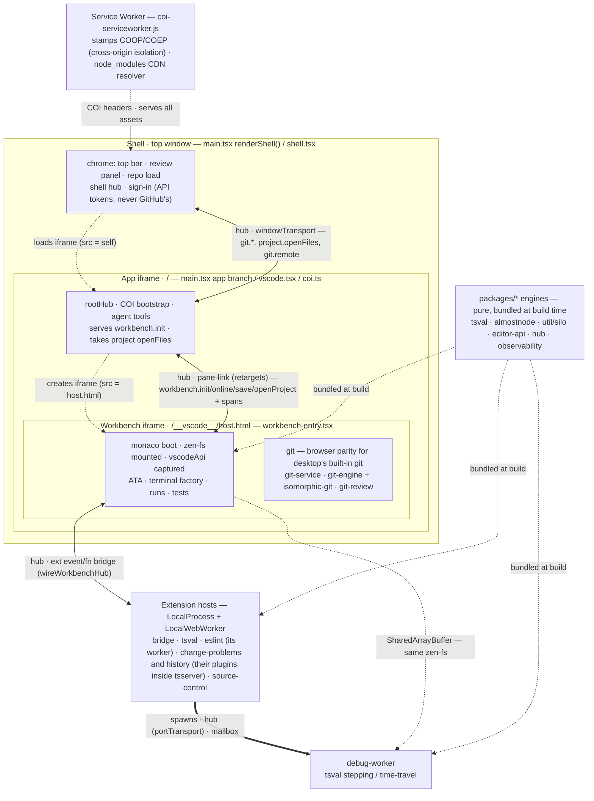

# editor — architecture & "where does this code go?"

The editor's core spans five runtime **realms** (separate JS execution contexts). Most "where should this live?"
confusion is really "which realm does it need to run in?" — so this doc is the realm map plus a placement procedure.
What an extension may plug into is *Extension points*, below; how a run's real effects are decided is *Capabilities*.

This is the core's architecture: the editor reduced to the least it needs to be worked in (*The rewrite, in place*,
below). What the full editor had — previews, the Margin, runtime evidence, notes, the features map, insights, the
event sheet, cspell and ESLint, docking, the live architecture diagram — is this file at the `full-editor` tag, and
each feature's ledger tombstone (`.silo/features.json`) says what it was and how to bring it back.

## The two axes behind every placement decision

1. **Which realm?** — decided by *what the code needs to touch* (DOM? the vscode API? the workspace filesystem?
   tsserver's Program? heavy CPU?). Placement follows the CAPABILITY the code needs, not the feature it belongs to.
2. **Engine or binding?** — a pure, reusable **engine** (fewest host deps, node-testable) kept separate from a thin
   **binding** that maps it into one realm. This axis cuts across every realm.

**Portability caveat — the tie-breaker on Axis 1.** The **workbench iframe** realm is *our* custom
monaco-vscode-api boot; it does **not** exist in desktop VS Code, and neither do the browser shims that recreate
what desktop ships built-in. Split product functionality by one question: **does desktop VS Code already provide
this?**

- **Browser-parity shim** — desktop gives it to you out of the box; we only rebuilt it because the browser lacks the
  underpinning (e.g. **git**: desktop's bundled git extension provides it, but that shells out to a `git` binary the
  browser has none of). This is a **browser-host concern**, not meant to port: keep it browser-side (the workbench
  realm, or a browser-only extension like source-control) and don't dress it up as a portable product extension.
- **Novel functionality** — desktop does *not* provide it (the feature ledger's drift in Problems, the stepping
  debugger). *This* should be **portable**: a self-contained **extension** (ext host, `vscode.workspace.fs`, spawning
  its own workers) that runs on both our browser host and desktop VS Code.

Reserve `workbench-entry` (the workbench realm) for host-**boot glue** proper (the monaco `boot()` call, mounting
zen-fs, the terminal process factory, registering extensions) — and for browser-parity shims that have nowhere more
natural to sit.

## The realms

| Realm | Entry / key files | Can access | What lives here |
|---|---|---|---|
| **Shell** (top window) | `shell/`: `main.tsx`'s `renderShell()` branch → `shell/shell.tsx`, its features (`shell/feature.ts`'s list) | DOM, the shell hub; the sign-in (`shell/session.ts`: a DPoP key and the API's tokens — GitHub's token stays in packages/api) | The page around the editor: the top bar (sign-in, the GitHub popover, Commit, Reset), loading a repository from GitHub, a push's HTTP, and the RHS **review panel** (`shell/git-panel.tsx`: GitHub-Desktop-style changes, diff and commit, a pure hub consumer of `git.*`). shell.tsx is its core (the page, the hub, the theme, the panel's place); each other part is a feature module it starts and places. Loads the app in an iframe pointing back at the same page. |
| **App iframe** (`/`) | `app/`: `main.tsx`'s app branch, `app/coi.ts`, `app/vscode.tsx`, `app/tools/` (the tab's MCP tools) | DOM, `rootHub`, COI bootstrap | Boots the workbench iframe and links it into `rootHub` over the retargeting pane-link transport; serves `workbench.init`, writes a loaded repository's files (`project.openFiles`) into the workspace, and serves the tab's agent tools to debug-mcp. Owns the top of the hub tree. |
| **Workbench iframe** (`/__vscode__/host.html`) | `workbench/`: `workbench-entry.tsx`, `workspace-fs.ts`, `git-engine.ts`, `git-service.ts`, `git-review.ts`, `git-push.ts`, `git-history.ts`, `terminal/`, `node-runner.ts`, `runs.ts`, `test-runs.ts`, `ata.ts`, `tarballs.ts` | **the vscode API *and* zen-fs** (both live here), DOM — but it is OUR boot, so nothing here ports to desktop VS Code | Host-boot glue: the monaco `boot()` (VS Code's full workbench lays itself out, minus the menu bar and title bar, which the shell's chrome replaces), mounting zen-fs, capturing the vscode API, the terminal process factory, registering extensions. And core's services, on the hub: git (the engine and service: browser parity for desktop's built-in git), the review's hunks, the run registry and runner, the tests for agents, packages and types from the CDN, the agents' workspace tools, the editor's state, the architecture store. |
| **Extension hosts** (`LocalProcess`, sharing the workbench's realm; `LocalWebWorker`, a worker) | `extensions/<name>/extension.ts`, `extensions/history/ts-plugin.js` | the vscode API (files through `vscode.workspace.fs`) — **no DOM, no zen-fs**; the hub only in `bridge` | One extension per feature (*Extensions: which one, which host*, below). `LocalProcess`: `bridge` (core's crossing into VS Code, and the only extension on the hub: the uplink, the workspace runtime and its files, every debugger's run-contract events, capability decisions and stops, the terminal's auto-attach — another's records reach it, for observability alone, through `observeExtension` as `ext:<name>`) and `tsval` (the stepping debugger), which needs what only that host has. `LocalWebWorker`: `eslint` (real ESLint and the preset under almostnode in a worker of its own, from a toolchain the build traces and packs; the web implementation of `dbaeumer.vscode-eslint`, its records on the hub through `observeExtension`), `change-problems` (a tsserver plugin of its own: TypeScript's side of a change's problems against HEAD, which core's code-problems.ts asks and the review panel shows on each changed file's row), `history` (reads the program and holds the ledger to it: drift in Problems, `history.decisions`; its plugin runs *inside tsserver*, reusing its `ts` and its Program), `source-control` (VS Code's Source Control view on core's git), and VS Code's own TypeScript extension. |
| **Workers** (`dist/lsp/*`) | an extension's own sit in its folder (`extensions/tsval/debug-worker.ts`, its modules in `worker/`, one feature's each) — only what is messaged in | nothing host-y | Heavy/blocking compute, off the UI thread: `debug-worker` (tsval stepping a program, almostnode for its packages; top-level, from the `LocalProcess` host), and — nested in the `LocalWebWorker` host — VS Code's two tsservers, history's plugin among them. |
| **Packages** (`packages/*`, plain node) | nothing host-y — pure | — | Engines: `tsval` (the interpreter, and its `observe` hook), `almostnode` (the node runtime a debug run's packages load in), `util/silo` (the ledger, the shared policy model: pure models and layouts), `editor-api` (what an extension imports of core's), `hub` and `observability`. Built/aliased into the realms above. |

There is also a **service worker** (`coi-serviceworker.js`, registered by `app/coi.ts`): one per origin, it stamps the
COOP/COEP headers that make every realm cross-origin-isolated (SharedArrayBuffer) on a static host, and resolves the
CDN `node_modules` overlay. Not a place you put feature code. It sits at the package root beside `index.html` and
`main.tsx`, because a service worker's URL is its scope.

**The folders are the realms.** A file's folder says which realm runs it: `shell/`, `app/`, `workbench/`, `workers/`,
and `extensions/<name>/` (that extension's host, and the workers it spawns). What more than one realm runs is in
`shared/` (`workspace-changes`, `theme`, the architecture reports, almostnode on the workspace as every worker that
runs a program has it: `zenfs-vfs`, `workspace-runtime`), and the shapes one realm serves and another reads (`runs`,
`git-hunks`, `git-remote`); build-time Vite plugins are in `build/`. What an *extension* imports of core's is
editor-api's, not `shared/`'s — the `.silo/` stores (`./policy`, `./effects`), worker failures (`./failures`), the
network probes (`./probes`), almostnode over the runtime's files (`./runtime-vfs`) — so an extension passes *Features
as extensions*' test (below). One exception, decided: tsval, the editor's own debugger, mounts the workspace's buffer as
core does (`zenfs-vfs`, `workspace-runtime`; *Extension points* 2). Lint holds the line (`no-restricted-imports`, the
root `eslint.config.js`): a relative import that climbs into another realm's folder — or, from an extension, another
extension's — is an error. Only `workbench-entry` reaches into `extensions/`, to register them; `main.tsx`, `build.ts`,
`dev.ts` and the tests may reach anywhere.

## Extensions: which one, which host

Two separate questions, and the second is mechanics, not features.

**Is it its own extension?** Yes — one per feature, using the public vscode API only, so it could ship to desktop VS
Code. A feature split across two extensions is a smell; two features in one extension is one too.

**Which host?** `LocalWebWorker`, unless it needs something only the `LocalProcess` host has:

| needs | why only `LocalProcess` | who |
|---|---|---|
| the hub | the hub is core's, and one extension is the way across (`bridge`); feature extensions get no hub, so subscribers don't spread to wherever is convenient | `bridge` |
| the workspace runtime — the workspace's `SharedArrayBuffer` and a runtime link per worker | `bridge` provides it (`workspaceRuntime()`, editor-api) in its own host; an extension's `exports` don't cross hosts | `tsval` |
| top-level workers | that host shares the workbench's thread, so a worker it starts isn't nested in an extension-host worker | `tsval`'s debug workers |

And one rule pulls the other way: **a TypeScript Program means a tsserver plugin, and a plugin means `LocalWebWorker`.**
VS Code's TypeScript extension finds plugins through `vscode.extensions.all`, which only sees its own host, and that host
is `LocalWebWorker`. A plugin runs inside tsserver with tsserver's own `ts` and its Program — every source file, parsed
and checked, unsaved edits included — reached from its extension by `typescript.tsserverRequest` (`_`-prefixed
commands). That's how `history` is built.

### Two libraries that aren't places

- **almostnode** is Node, emulated — a library each worker that runs Node code creates its own instance of: the
  `debug-worker`, for a program's packages. Nothing shares an instance.
- **TypeScript** comes as two copies. VS Code's is inside its tsservers, and history's plugin borrows it. Ours is the
  `lsp/typescript-*.js` chunk the `debug-worker` imports: one file to download, but each worker that imports it holds
  its own instance.

## Cross-realm communication

- **hub** (`@brianjenkins94/hub`) — the composed message tree for *everything*, including the workbench boot
  handshake: pub/sub + RPC (`createRpcClient` / `serve`). Shape today: shell ↔ app over `windowTransport`; app
  `rootHub` ↔ workbench hub over the **pane-link** transport (`pane-link.ts`) — a `windowTransport` variant that
  *retargets* to the pane's live window so it survives a pop-out; workbench ↔ extension bridge over the bridge's exported
  event/function bridge; bridge ↔ its workers over `portTransport`. A message only crosses a link if the far side
  subscribed, so each realm runs standalone. The app↔workbench boot handshake is just hub messages on that link:
  the pane requests `workbench.init` (RPC, retried until interest settles), then publishes `workbench.online` /
  `workbench.save`, and the host publishes `workbench.openProject`.
- **plain postMessage** — only where the hub can't or mustn't go: a protocol dictated by someone else (the debug
  protocol, tsval's own), or a realm that must stay bare. A worker that runs a program joins the tree through the
  workspace runtime's link (editor-api's `connectRuntime`): its log, spans and servers are the editor's, its calls get
  timeouts and worker-failure handling from the hub, and it shows up by name in the architecture reports.
- **shared memory** — the workspace filesystem (below), and a debug worker's mailbox for the runtime's files
  (*Extension points* 2). No messages at all, so the architecture reports observe the workspace by wrapping each realm's
  `/workspace` mount (`architecture-zenfs.ts`).

### Previews (out until reintroduced)

The rewrite took previews out (*The rewrite, in place*): the node worker's in-browser Vite dev server, the preview
windows, their taps and evidence, and the service worker's `/__virtual__/` routing and capability gate. How they
worked is this file at the `full-editor` tag. A debug run's own server is still answered (the workspace runtime's
`answerServer`, editor-api's runtime link), with nothing asking it until previews come back.

**The service worker keeps no state.** The browser stops an idle service worker and starts a fresh global on the
next event, so it remembers nothing between requests: it asks the page for a hub link whenever it starts
(`sw-needs-hub`). It stamps cross-origin isolation onto what it passes through and serves `node_modules` from the CDN.

**One service worker serves every tab.** It links each tab's root hub separately and **non-transit** (a hub link
option: nothing passes between two non-transit links), so tabs are never joined through it. debug-mcp links every open
tab the same way (non-transit), for the same reason.

### The workspace filesystem (zen-fs)

The workbench creates a 128 MB `SharedArrayBuffer` zen-fs store (`workspace-fs.ts`) mounted at `/workspace` and hands
the buffer to a debug run in its launch (the bridge holds it). All of them read and write the same bytes under an Atomics lock.
Its size is fixed (zen-fs reads it once), and SingleBuffer takes ~2.5× the files' size: this repository's 26 MB of files
(the tree, the types in node_modules, .git, .silo) took 54 MB. At 64 MB a fresh clone took half, and a day of pulls —
a pack each, which nothing collects — the rest, and a pull failed for room (2026-11-03). Bigger isn't free on paper: V8
holds only the pages written (a 512 MB buffer filled with this tree used the memory a 64 MB one did), but the browser's
memory measurement counts a SharedArrayBuffer at its size, so the workbench's memory budget sees all of it (256 MB read
395 MB against its 300). Collecting the packs is the fix that lasts. Files persist to IndexedDB one by one, not as the buffer. The metrics plane's fill gauge
(editor-metrics.ts `workspaceFill`) reads the allocator's high-water mark, freed space included, so it overstates how
full the store is.

Shared memory tells nobody anything, so there is **one change stream** (`workspace-changes.ts`): each realm watches its
own mount's mutating store operations and reports them, batched, as `workspace.changed`. The workbench persists every
change to IndexedDB (`workspace-fs`, 500 ms debounce — it copies the path's current state, so a deleted or renamed tree
goes with it) and announces it to VS Code as a file-change event (except `.git/**`, whose writes the git watchers
cause). So a write is saved and seen the same way whoever made it: the editor's provider, isomorphic-git, the terminal,
a debug run. The architecture reports label workbench operations by caller (`vscode ·`, `direct ·`, `seed ·`,
`restore ·`, `persist ·`).

### The metrics plane

Beside the logs (`$sys.log`) and the architecture (`$sys.arch`), each context can publish numbers once a second on
`$sys.metrics.<source>` (observability's `reportMetrics`: named gauges, read at each sample). The workbench reports
memory by realm (`measureUserAgentSpecificMemory`, about every 30 s: it waits for a garbage collection), the
workspace's fill (read from the zen-fs superblock), its time in long animation frames, hub traffic and the origin's
storage; the shell reports its own long frames (`editor-metrics.ts`). Memory is named by realm: the editor's own by
path, and the `blob:` workers (the web worker extension host, TypeScript's servers, monaco's workers) by the
architecture probes, which put each worker's URL on its node (the workbench's architecture store,
architecture-store.ts) — a probed worker reports its own in its `hello`.

The host page reports `spans`: every context's timed spans (`→ cdn` / `← cdn (12ms)`) as rates, errors and latencies per
`source/name` — ended per second over the last 10 s, how many had an error logged inside them, p50/p95, and how many are
open — computed from the records its collector already receives, so no subsystem does anything to be measured.
debug-mcp keeps five minutes of each tab's plane: `metrics_query` summarizes any series over a window (latest, min,
max, mean, and the readings when asked). The performance suite reads the workbench's memory from it.

## Diagram — realms & channels

Edge styles: **solid arrows** = live message channels; **thick arrows** = a realm spawning a worker; **dotted arrows**
= frame creation, shared-memory, service-worker serving, and build-time bundling. Nesting = iframe containment
(shell ▸ app ▸ workbench).

## Discovered, not declared

What the editor is, at run time, is discovered from the running editor rather than kept by hand — a hand-kept model of
96 subject families had drifted (built 2026-10-04 to 10-19):

- **Contexts, links, messages, side channels.** Every hub announces itself and its links on `$sys.arch` (observability's
  reporter), counting each message's subject, direction, size and kind per link; probes report network requests,
  workers, window messages, `MessagePort`s and each realm's `/workspace` operations, labelled by caller.
- **Extensions, by their own API.** The build hands every bundled extension a `vscode` whose `commands` are counted
  (extensions/command-tap.ts, build/command-tap.ts); each host sends its totals to the bridge
  (`editor.arch.commands`), which reports `ext:<name>` nodes and `cmd …` edges. Commands nobody bundled registered
  belong to `ext:vscode`; an extension installed from the gallery isn't tapped.
- **Stores, by what's written.** The zen-fs probe records each read, write, create, unlink and rename in a tool's
  dot-directory, paths of one shape collapsing to one store (shared/architecture-zenfs.ts `storeShape`); the command tap
  counts `workspace.fs` the same way; the IndexedDB probe names each database.
- **Flows, by causality.** Every hub message has an `id`, and one sent while a hub runs another's handlers names it as
  its `cause`; an RPC call takes its cause when it's made, a reply names its call, and a call a queue defers names what
  it was queued for (`handlingMessage`, RpcRequestOptions' `cause`). The browser has no async context, so where the
  trace is lost, observability's `flowsOf` links a message to the last one its sender received within 50 ms, marked
  inferred.

What can't be: what never ran; intent (which way a subject may travel); a component's insides; the file and line.

Where it's read: the workbench's architecture store (workbench/architecture-store.ts), which names workers for the
metrics and is what the architecture harness watches the editor boot by (`globalThis.__architecture`); and debug-mcp's
own, which `architecture_state` answers from. The live diagram that drew it, and the declared model of what may talk to
what that it was checked against, went with the rewrite's reduction (their tombstone is in the ledger).

## Placement procedure

Ask, in order:

1. **Pure logic, no host deps?** → a **package / engine module** (node-testable). *e.g. `git-engine` (no vscode dep),
   `silo/policy`, `git-hunks`.*
2. **NOVEL product functionality** (desktop VS Code does *not* provide it)? → a self-contained **extension** in the
   ext host, reaching the workspace through **`vscode.workspace.fs`** (never a direct `zen-fs` import), and
   **spawning any heavy worker itself**.
   - **2b. Browser parity for a desktop built-in** (desktop provides it; we only rebuilt it for the browser — e.g.
     git)? → keep it **browser-side** (the workbench realm, or a browser-only extension). It does **not** port,
     so do not make it a portable product extension.
3. **Needs tsserver's Program / to run during type-checking?** → a **TS-plugin in the WebWorker ext host**, reusing
   tsserver's `ts`. *e.g. `history`.* (A special case of rule 2 — it ships in an extension.)
4. **Heavy or blocking** (parse, interpret, run node)? → a **worker**, async. Spawned by whoever owns it — the
   *extension* for extension functionality (portable), the workbench realm only for host-boot workers.
   *e.g. tsval's `debug-worker`.*
5. **Chrome / layout / cross-project / token custody?** → the **shell**, as a feature module (shell/feature.ts).
6. **Host-boot glue only** — things that only make sense for our monaco-vscode-api boot (the `boot()` call, mounting
   zen-fs, the terminal process factory, registering extensions)? → the **workbench realm** (`workbench-entry`). This
   is the *only* thing that legitimately lives there, because it does not port to desktop VS Code.

Then apply **Axis 2**: split the part with the fewest host deps into an **engine** and leave a thin **binding** in
the realm. If you can't node-test the logic, you probably haven't separated the engine yet.

## Worked example: git

`git-engine.ts` + `git-service.ts` are **browser parity for desktop's built-in git** (rule 2b): desktop ships the git
extension; the browser has no `git` binary, so we rebuilt git over isomorphic-git + zen-fs. The engine lives
**browser-side** (workbench realm) behind one service on the hub (`git.status`/`git.file`/`git.commit`, `git.changed`),
with three faces: VS Code's Source Control view (`extensions/source-control/`, a browser-only extension, through the
`editor.git.*` commands; a change is a file change, as its watcher sees it), the shell's GitHub-Desktop review panel
(`git-panel`), and the terminal's `git`. We do not ship it to desktop; desktop already has it. (`git-engine`'s direct
`@zenfs/core` import is fine *here* — it's browser-only.) A push (`git.push`, beside `git.branch` and `git.checkout`) is
the engine's isomorphic-git with the shell's HTTP: its requests cross as `git.remote` (shared/git-remote.ts) to the
shell, which holds the sign-in and sends them through the API's proxy (shell/git-push.ts); the shell also says who a
commit is by (`git.identity`, the signed-in GitHub user). What part of a file a commit or a discard takes is the
service's too (shared/git-hunks.ts): the panel names the changed rows it leaves out, an agent the hunks it picks, by
the ids `git.review` gives them (git-review.ts).

## The one gotcha the realms impose

Cross-origin isolation (SharedArrayBuffer) must hold in **every** nested realm. The shell → app → workbench nesting
is all same-origin, and the service worker (prod) or dev headers stamp COOP/COEP, so isolation propagates — but a
new realm (another iframe, a worker) inherits it only under those same conditions. When adding a realm, confirm
`crossOriginIsolated` there before relying on SAB/Atomics.

## A worker's globals, and its failures

A worker has only a worker's globals, and code that reads one it lacks as it loads (util's env reads `process`) fails
before anything in the worker runs. A shim at the top of the worker's entry doesn't help when the bundler shares the
module with another entry: it becomes a chunk of its own, and an entry's imports load before its own code. So a worker
whose code needs a shim gets a build of its own, with the shim on every chunk (`build.ts`: the package worker, 2b, and
the tsserver engines); and `test/worker-realms.mjs` loads every `dist/lsp` entry as it's started, in its realm (a bare
worker, or tsserver's with its `ts` handed in), and names any that can't load.

Whoever starts a worker watches it (editor-api's `./failures`: `watchWorker`): its failure to load, or an uncaught error in
it, is said once, by its name and with where it happened (`[debug-worker] couldn't load: … (…/lsp/env-….js:12)`), and
kept from going on up — unwatched, it reaches the realm that started it and that realm's starter in turn, each saying it
under its own name. An extension's bootstrap reports its module's failure the same way (`{ failed }`, with the stack).
What waits on a worker that never loaded stops waiting: a debug session ends, and the architecture harness fails the
wait in progress with the realm's reason instead of timing out.

## Extension points

What another extension can plug into: the seams editor-contrib's template (`contrib/`) uses. Started 2026-10-08, after
editor-contrib showed that an extension point we don't use ourselves drifts: its interpreter talked to the editor
through DAP custom events while tsval went around them, straight to the hub.

**The test.** An extension point is real when **our own code goes through it**: tsval is the run contract's and the
workspace runtime's user, so every run of the editor exercises what a contributed debugger relies on, and a change that
breaks one breaks ours first. Where VS Code has the extension point (a debugger, a view, a command, `contributes`), we
use VS Code's: a documented contract, other people's code already written against it, and what's contributed stays
portable to the desktop (the hub is core's, and the bridge is the one way across it).

**An extension is a folder** (2026-10-14): its package.json, its `browser` entry, and each file its manifest's `files`
lists (npm's field), registered at that path, so it opens them as `extensionUri`'s (workbench/extensions.ts). The
editor's own load that way too, so a contributed one can ship what they do (a worker it starts, a tsserver plugin's
package) instead of inlining it. An extension from outside the editor loads by URL: the site's `extensions.json`, and
`?extension=` while one's developed.

**What an author imports** is one package, `packages/editor-api` (released like hub, on the site as
`packages/editor-api@latest.tgz`; its package.json says what each export is). editor-contrib depends on it; the bridge
and tsval import the same types. Its `Symbol.for` keys keep its old name, `run-contract`: they're how a published copy
and core find each other.

### 1. The run contract

A debugger is a runtime: what it reports goes to the run registry (what's running) and the run's effects. The events,
requests and launch configuration are editor-api's (its index.ts says what each means). tsval tells all of it through
the contract; the bridge reads every debugger's the one way (debug-events.ts), and capability-stops.ts says what each
answer at a capability stop means. What a run is (its registration, its exit code, its output and input in the
terminal) is the bridge's, for any debugger.

A debugger in another extension host (editor-contrib's) is followed by what VS Code tells every host: no tracker sees
it, so an agent doesn't see its output.

### 2. The workspace runtime

What the contract can't carry: a debugger's worker reads the workspace synchronously (`require`, `readFileSync`).
**Any debugger may have it**, not just tsval: an interpreter like editor-contrib's should be able to run real programs
against the workspace. The interface is editor-api's `./runtime` (`workspaceRuntime()`, `connectRuntime`, `serve`); on a
desktop build it's Node's own `fs` and `net`.

Underneath, the port is a link into the editor's hub, so the worker stays a realm of its own: its spans, its logs and
each server's traffic (`server:<port>`) are the editor's to see. The extension's own code never joins the hub; the
bridge stays the one bridge.

**Across extension hosts** (measured 2026-10-10, Brave, the dev build). An extension loaded from outside the editor
runs in the web worker extension host, and an extension's exports reach only its own host, so core puts the runtime in
each host instead of exporting it. What handing a port across hosts meets:

- **The workspace's buffer would cross.** The web worker host's iframe is same-origin (`allow-same-origin`,
  `cross-origin-isolated`) and the host is cross-origin isolated. A `SharedArrayBuffer` posted from the workbench down
  a `MessagePort` to a worker that iframe made is the same memory both ways.
- **An extension can't open the way itself.** VS Code blocks `postMessage` for that host's extensions, so an extension
  can't send a port out. Core has to be in the worker before that, as the architecture probe is (its bootstrap runs
  first and posts a port up through the iframe, probes.ts). From there, a host's extensions share its global scope,
  and an extension posting to a worker of its own (tsval's way) isn't blocked.
- **`BroadcastChannel` is no way round:** it delivers a `SharedArrayBuffer` as `null`, even within one realm, and
  carries no ports.

#### The runtime's files, through core (decided 2026-10-10)

A contributed debugger doesn't get the workspace's buffer. It's our storage format (patched zen-fs's SingleBuffer: a
second zen-fs mounting it can break the filesystem's structure, `.git` and `.silo` with it), and the bytes are below
everything the editor keeps around a file: an open editor's unsaved text, change events, the policy, the run's
effects. It gets **synchronous files through core** instead, each call answered by the bridge (runtime-fs.ts):

- **The wire.** The worker hands the bridge a small `SharedArrayBuffer` of its own, a mailbox, once. A call is the
  worker writing its request into it and waiting (`Atomics.wait`); the bridge, watching it (`Atomics.waitAsync`),
  makes the call and writes the answer back. No message a call, and one connection (the port), as before. VS Code's
  TypeScript server on the web reads its files the same way.
- **A read** is an open editor's text when it's open, else what's on disk; **a write** is the workspace's, so editors,
  Source Control and watchers see it. Paths are `/workspace`'s, failing as node's do.
- **Packages.** A package's published tarball, for one the debugger's `require` finds nothing of (the editor serves
  packages from a CDN, and type acquisition writes only their types), at the version `versions.json` pins (`.silo/`'s, or its local copy: RUNTIME-EVIDENCE.md, *Storage in git*). The
  worker unpacks it into its own memory, never the workspace's buffer, which is no place for node_modules. A package
  the policy bans is never fetched. What no CDN serves is in the workspace's node_modules already, as npm puts it
  (workbench/install.ts, run by each sync of the versions, so `npm install` is that sync): a `file:` dependency is a
  symlink to its folder, which zen-fs follows in every realm, and a tarball from anywhere but npm's registry is
  unpacked there. A folder wins over a tarball for the same name: it's the source that gets edited. TypeScript in the
  browser doesn't resolve symlinks (its host's `realpath` only normalizes a path), so the capabilities tsserver plugin
  answers `realpath` from the versions' `link`s, and a linked file has one name, its folder's.
- **The gate.** A call is the program's unless it says it's the debugger's own load (the program and what it imports,
  read-only). The program's are decided by the session's policy as tsval decides its own: allowed, skipped, or failing
  with `EACCES`; a live run makes no write. The session is the one the extension named to `connect(name, session)`,
  bound to the link, so the worker and the program in it can't run under another. The gate protects the workspace
  from the *program*, uniformly, whichever debugger runs it. It isn't a wall against the extension, which has
  `vscode.workspace.fs` like any extension.
- **Effects, kept by core.** Each program call is counted among its run's effects as it's answered, so a debugger's
  `effects` event tells only what the editor didn't see: the requests and commands it made itself.
- **From either host.** `workspaceRuntime()` finds it where core put it: in the bridge's host, the bridge's (the
  buffer included, for tsval); in the web worker host, core's (components/monaco-vscode-api/runtime.worker.ts, loaded
  by core's bootstrap before VS Code's extension host, its ports going up the port the architecture probe reports
  over), with no buffer.
- **One way to link it** (`linkRuntime`), whichever host the port comes from. The worker is named `<name>#<instance>`,
  its own id (an answer goes to that worker alone; the architecture reports count each as an instance of `<name>`), and
  the link carries only the runtime: the worker's log, architecture and metrics, its mailbox, its servers' requests
  and answers. No other service of the editor's, tsval's worker's included.

**tsval's privilege, decided** (2026-10-15). tsval's program's calls go through the runtime's files too (almostnode
over editor-api's `./runtime-vfs`), so core is the one gate for every debugger's programs; tsval still stops and asks
at a call (a debugger's job) and gives a rule's result in a call's place. Its module loading keeps the buffer: never
gated, and measured, a mailbox call costs ~0.5–0.7 ms (the read ~0.17 ms of it) and a run's loading makes 2 (a script)
to 10 (two local modules) calls, 32 for one package it couldn't find, hundreds with real packages, every live run
again. So tsval, the editor's own debugger built with core's zen-fs, mounts the buffer as core runs it
(shared/workspace-runtime, shared/zenfs-vfs: the two `shared/` files the realm lint lets it import). Never a
contributed debugger's. Everything else tsval uses is a contributed debugger's too (editor-api's `connectRuntime`,
`./runtime-vfs`, `tarballUrl`), or its own (capability-calls.ts, canary.ts).

**Any extension on the observability plane** (2026-10-15): `observeExtension(name)` joins an extension, a contributed
one too, to the editor's hub through the same link, as `ext:<name>`, for its logs and metrics alone; nothing of the
editor's services crosses. Not its console: the extension host is every extension's.

### 3. The commands an extension may run

Every command core answers that an extension may call: the list *Features as extensions*' test (below) holds a feature
to. A command not here is core's own, and an extension that calls one doesn't pass.

| Command | Answered by | What it is |
| --- | --- | --- |
| `editor.git.status`, `.file(path)`, `.commit(message)` | core's git (git-service.ts) | the workspace's changes (`{ files: GitFileChange[], head? }`, editor-api's `./git`: path, status, staged, unstaged; `head`, HEAD's commit), a file's HEAD text (`{ head, working }`), a commit of everything (`{ oid }`). No change event: a change is a file change, as a watcher sees it (the Source Control view refreshes so) |
| `editor.capability.decide(session, choice, rule?, give?)` | the bridge (capability-stops.ts) | a capability stop answered: `choice` a `CapabilityChoice` (editor-api): allow, skip or deny for this call, this run or always; `give-once`, `give` in the call's place. What a choice means is the bridge's decider's |

**Not for extensions:** `editor.arch.commands` is command-tap's (extensions/command-tap.ts), which core's build puts in
every extension it bundles, so the architecture reports see which extension registers and calls what. A contributed
extension isn't tapped.

### 4. VS Code's own contribution points

Where VS Code has a contract for what we'd build ourselves, we use it: Source Control, diagnostics (the ledger's drift
is History's, in Problems), configuration, debuggers; the terminal speaks shell integration. Agent tools (app/tools/)
aren't `contributes.languageModelTools`: those are tools for an agent inside VS Code (its chat), and VS Code isn't an
MCP server that hands them to one outside. Our agent is outside: debug-mcp reaches the tab over the hub.

### 5. The capability decider

The bridge's decide.ts (extensions/bridge/capabilities) asks the policy; what the policy leaves undecided is refused,
and said once (the shell's prompt that asked a person went with previews). The decider is the seam: a contributed
decider (an AI, an elicitation, a team's or CI's policy) answers instead. Not built: it waits until a second decider
needs it.

### A desktop build

What a desktop VS Code extension of this would meet, as the code stands: the feature extensions are hub-free and run as
they are; the run contract's layer is DAP and public API. What breaks is what the bridge reaches over the hub, because
core isn't there:

- **The workspace runtime** → Node's `fs` and `net` (2's interface); tsval's worker → `worker_threads`.
- **Core's services that are just code** (the run registry, the ledger's reading) → moved into an extension; git → VS
  Code's own.
- **The browser runtime** (the service worker, just-bash, isomorphic-git) → dropped for the real thing (the terminal,
  git).
- **Agent tools** → `languageModelTools` or an MCP server.

## Features as extensions (2026-10-13 → 15)

Each feature one folder, written as editor-contrib's template is: against VS Code's API, editor-api and the commands
*Extension points* 3 lists, nothing else. A count of `packages/editor` (35k lines) had found most features spread over
three to five folders. Moving files doesn't get there: a feature's code sits in `workbench/` or the bridge because
something it needs has no public way in. So the work was the missing seams: every extension loads from a folder; what
extensions imported from `shared/` is editor-api's; the commands an extension may run are listed; git is `editor.git.*`
commands, so Source Control is `extensions/source-control`.

**The test.** A feature passes when it could ship in editor-contrib's place: its imports are `vscode`, editor-api and
util; the commands it runs are VS Code's or *Extension points* 3's; its files load as a contributed extension's do. The
shell's chrome and the workbench's boot aren't VS Code augmentations and aren't held to it.

**Decided, and kept:** tsval keeps the workspace buffer, a documented editor-only privilege (*Extension points* 2);
command counts stay command-tap's (core's command service can't tell which extension made a call); the capability
decider stays in the bridge until a second decider needs it (*Extension points* 5).

**Holding the line.** The realm lint (root `eslint.config.js`) stops an extension reaching another's folder, a realm's,
or `shared/` (only the bridge, core's, may; tsval its two files). A feature that moves takes its tests, and core keeps
no fallback for the old way.

## The rewrite, in place (2026-11-02)

The editor's composition is rebuilt feature by feature, in this repository. That's the shell, the workbench, the
composition roots and the extensions: about 20k lines of glue. almostnode, the BABLR packages, tsval, the site and the
API's apps are fine as they are. Why in place, the user's decision: the secrets, deploys, CI and configuration stay as
they are, untouched, and the rewrite is done *in the editor*, by people or by agents over debug-mcp. So the rewrite is
also how the editor becomes the place this repository is worked on. Something the rewrite needs that the editor can't
do yet is the editor's gap: it goes in NEXT.md, not around the editor from a local shell.

**Reduce, then reintroduce** (the user, 2026-11-02). Not a port of one feature at a time beside the rest, and no
allowance for code not yet ported: the editor is reduced to its minimally necessary core, and features come back one
at a time, each with a purpose.

1. **Measured first**, while all the code is there: the zero-knowledge baseline, what BABLR parses, the comments sorted
   (below), and the whole test suite run one last time for each test's reach and outcome (*Tests*, below). The manifest
   is the record of what there was (superseded, kept as that snapshot: *Silo, firmed up*).
2. **The core, declared**: the least the editor needs to be worked in, since the rebuild is worked in it. Candidates,
   not decided: the shell and the workbench's boot, the workspace filesystem, git (clone, review, commit, push), the
   hub and observability, the agents' workspace tools, the ledger and `silo check`. Each is declared in the ledger, so
   code no feature owns is an error from the first commit (packages/silo/README.md, decision 22).
3. **Everything else removed**, each feature with its ledger tombstone (`silo remove`) and its tests: out until it's
   reintroduced. Git keeps its code and tests, for reintroduction to read, not to copy back.
4. **Reintroduced, one feature at a time, only with a purpose**: declared first (its name, what it's for, the ways in,
   paths and tests it owns: decision 21), built to the standard, its spans as CLAUDE.md says, its whys as notes, its
   tests green, its zero-knowledge pass run again. A feature with no purpose now stays out.

**Tests, eliminated and rebuilt with their features** (the user, 2026-11-02). The suite isn't ported: it goes with
the code, and a feature's tests are written again when it comes back, declared in its entry, so every test is
attributed by declaration from the first one (packages/silo/README.md, decision 13), and a test's file is code its
feature owns (decision 22). The core's tests are the first written.
- **The old suite is the record of what was tested.** Its last run (step 1) keeps, per test, what it reached and how it
  came out: CI's ledger and the editor's traces. A removed feature's old tests are what that feature was held to. When
  it's reintroduced, what its old tests reached and its new ones don't is shown: a behaviour dropped on purpose, said
  so with its reason, or a test still missing. That's how existing behaviour is codified rather than lost with the
  tests. The old tests are read beside the new, at the tombstone, as its old code is.
- **How a test looks** is part of the standard: it sets up its own state, so it can rest or be vouched for alone
  (decision 15, answered for the new suite by writing it that way); it belongs to one feature, and a test across
  features belongs to the one whose behaviour it states; it runs in the editor, on tsval, and on CI's runtime
  (decision 19).
- **Where it leads: fewer tests in CI.** A rebuilt suite starts with every test *new*, so CI runs all of it at first.
  As it settles, two things take tests off CI: a test green 20 runs in a row and not reached by a change *rests* until
  the weekly full run (decision 14), and a test that passed in the editor at commit is *vouched*, so CI skips it for
  a week unless it failed lately, can't run where it was vouched, or is audited (*Vouches*). The editor's commit flow
  makes the vouches, so working in the editor is what lets CI run less.

**The bench does it, for any repository.** This rebuild is the refactor bench's first job (NEXT.md item 1), and what
it takes is the product: a prototype-grown repository measured, reduced to a declared core, and its features
reintroduced with purpose, by a person and agents in the editor. None of the steps is this repository's own: the
ledger, ownership and attribution are silo's, for any repository (packages/silo/README.md), and the bench's tools are
any workspace's. So each step is built as the bench's, and this rebuild is its first user. What each needs:
- **Measure**: the zero-knowledge pass as a bench tool, its questions from the ledger, answered by an agent through
  the workspace tools. "Comments stripped" can be a layer over the workspace rather than a copy, as the workspace
  already layers overlays. BABLR's parse status per file exists (the bridge's).
- **Declare**: a feature declared from the bench (name, what it's for, ways in, paths, tests) into the ledger. The
  features map sets a status only.
- **Own**: decision 22's error in Problems, where History's drift shows today.
- **Reduce**: History's Remove (`removalOf`: what only it reaches, and its tombstone) exists for one way in; reducing
  is that for every feature not declared core, reviewed as one change.
- **Reintroduce**: a removed feature as it was, beside the work: its code at its tombstone's commit, its notes, its
  tests and its baseline answers, to read rather than copy, and what its old tests reached that its new ones don't.
- **Tests**: the feature's list (packages/silo/README.md, *Tests by feature, in your face*), its tests run in the
  editor, and the vouches its commit flow makes.
- **Shared code**: runs and coverage by feature (coverage and traces exist; by feature, not yet).
- **Progress**: the features map's core, out and back, and for each one back, how much of its old tests' reach its
  new tests cover.

**Comments become notes**: the core's, and a reintroduced feature's old ones, read as it comes back. About 16% of
packages/editor's lines (outside tests) are comments. Each one is:
- dropped, when it says what the code says;
- kept, when it's for a tool: `eslint-disable`, `@ts-expect-error`, a license;
- a note, when it's a why, a gotcha or a history, on the declaration or statement it sits on (*Durable annotations on
  spans* in RUNTIME-EVIDENCE.md; `pickAnchor` for the span);
- a note citing a doc, when it points at one (`FILE.md, *Section*`).

Agents read notes where they'd have read the comments: `decisions_for` returns a file's or a name's notes beside the
ledger, the manifest and the docs. `files_read` can show them inline, where the comment was. `files_edit` says when an
edit leaves a note without its code. A file BABLR can't parse can't hold notes, so what of the scope it parses is
measured first (BABLR's grammar has gaps on module code).

**What's self-explanatory: the zero-knowledge pass.** Per feature, a fixed set of questions: what it's for, its ways
in, what owns a given piece, why it's the way it is, what removing it takes. They're drawn from the manifest (what) and
the ledger and docs (why), which are the answers. Agents answer them through the editor's tools in three conditions:
- the code alone, comments stripped;
- the code as it is;
- the code, comments stripped, with notes through the tools.

The first against the second is what comments carry today. The third against the second is whether notes lose any of
it. Each question the code alone gets wrong is fixed one of three ways: the code says it (a name, a structure), a note
(a why the code can't), or a doc (it spans many places). A feature's pass runs again when it's reintroduced, against
its baseline.

**How the code looks** is written from the gaps the pass finds, each rule beside what checks it (ESLint, `silo check`,
or the pass). Likely: folders are realms; a feature is an extension (*Features as extensions*, above) and registers its
own ways in (composition roots registering for many features are what the manifest's derivations couldn't follow:
packages/silo/README.md, *The feature manifest*); no prose comments, only the kind tools read. The first feature
reintroduced is the worked example the rules point at.

**The architecture, reassessed.** A feature's boundaries are drawn before it's declared, so the extensions were looked
at again before the reduction, one feature to an extension. Done 2026-11-02: the bridge is core's crossing alone (the
uplink, the workspace runtime, the run contract's events, capability decisions and stops); History reads the program
and holds the ledger to it; the shell is a core and feature modules (shell/feature.ts). insights, margin, the features
map and the rest went with their features, and come back one feature to an extension.

**Silo, firmed up.** Silo's capabilities grew session by session (packages/silo/README.md, *The four jobs*, *What
doesn't fit*). The rewrite settles each one: the job it serves, where it lives (lib `util/silo`, pure; the command
line; the editor), and what supersedes what. Where it starts:
- **The manifest is superseded** by tracking features and their tests and attributing code from them (CLAUDE.md,
  *Features*). What reads it moves to the ledger's declared features and that attribution, or goes:
  - `silo check`'s drift, `silo features --score`, and `removalOf`'s rewrite of it;
  - History's `history.features`, which feeds the features map, `git_review`'s features per hunk, and focus;
  - `history.decisions` and `history.reach`, which agents call as `decisions_for` and `code_reach`.
- **Code no feature owns is an error** (decided 2026-11-02; packages/silo/README.md, decision 22): owned by
  declaration, in the ledger, not inferred. Attribution from runs and tests checks a declaration (*Declared against
  observed*), it doesn't stand in for one. Runs and coverage are also how code shared between features is found:
  what more than one feature's runs reach is made a feature of its own, or split.
- **One attribution of runs to features**, where there are two (`coverage` and `exercise`, *What doesn't fit* 4).
- **History's three features** (above) are split by what's silo's and what's the editor's view of it.
- **The rest of *What doesn't fit*** (two stores of what code can do, the subcommands, the leftovers) answered, or
  carried on with a reason, and decision 21 with them.

**Visibility: anything we'd ever debug, without a profiler.** What exists: the metrics plane, span rates and latencies
from every context's `→ x` / `← x (12ms)` records, the workspace's fill, and each zen-fs store operation counted as an
architecture edge by caller with its bytes (`observeZenfs`). What it didn't show: the repository's load (NEXT.md item 1)
was explained by CPU profiles and hand-placed logpoints counting the provider's calls (~190,000 for 14,000 paths) and
finding who walked the tree. So every boundary between the filesystems is a span: VS Code's file service into the
workspace provider and the node_modules provider, zen-fs (its operations timed, not only counted, and its path
lookups), the IndexedDB write-back, the change stream, isomorphic-git's reads, the terminal's fs, runtime-fs, and
almostnode's. Each with its caller, operation, duration, bytes and parent span, so one call can be followed down through
the layers. Aggregates are always on (per source and name, as span metrics are); single spans are kept on demand, as
`editor_trace` keeps VS Code's log.

Built so far (2026-11-03): every call at the workbench's boundaries is counted by boundary, operation and caller —
calls, time, distinct paths, bytes — as the metrics plane's `fs` gauge (shared/fs-boundaries.ts): VS Code's file
service into the workspace provider (`provider`) and the node_modules one (`node_modules`), every zen-fs store operation
timed (`zenfs`, `zenfs-local`), the write-back (`indexeddb`, and a span per flush), the change stream (`changes`), and the workers' file calls
through the bridge (`runtime-fs`, by the worker's kind: `eslint`, a debugger's — once a span each, thousands a second);
git's status walk is a span. Who asked is named by whoever calls the store (shared/fs-caller.ts): the provider
(`vscode`), the boot (`seed`, `restore`), the write-back (`persist`), type acquisition's probes (`has`), npm's links
(`install`), a project's writes (`project`), the terminal, and git — isomorphic-git through an fs whose promise calls
are answered by their synchronous twins, since zen-fs's await before reaching the store, past where a name holds. A
call no one named is sampled (one in 200, its stack's function names: `zenfs-unnamed`); after git's, none were left. The test it passes: the questions of 2026-10-30 and 31 (calls per path, who walks
the tree, what the write-back costs) answered from `metrics_query` and `logs_query` alone. The core holds to it; the
other realms' boundaries (the workers, BABLR, TypeScript's servers) are held to it as their features come back.

**Progress is the ledger**: what's core, what's out, what's back, shown in the features map, each with its pass's
score. No new silo subcommand.

**Decided (the user, 2026-11-02):**
- **main is reduced; the full editor stays deployed.** History is the features coming back, commit by commit, on main.
  The last full state is tagged `full-editor` before the reduction: browsable on GitHub, a worktree away locally, and
  read from in the editor (which fetches the tag: its clone is otherwise one commit deep). Production keeps the full
  editor by skipping only its deploy step while the rewrite runs (the API, admin and site deploy as before), so the
  full editor works on main until the core can host its own work.
- **The core is the candidates in step 2 plus running tests** (tsval and the test runner), so the core's tests run, and
  are vouched for, in the editor from the first commit.
- **A declared feature's ledger entry holds what the manifest held, and the ledger becomes the source of truth**:
  `what`, `docs`, `paths`, `ways` and `tests` beside `status`, `why` and `since`. `silo check` errors on any drift
  between it and the code, as it does on the manifest's now; the manifest goes when its entries have moved
  (packages/silo/README.md, decision 21).
- **Ownership is checked by file** (decision 22): a feature's `paths`. Runs, tests and traces give continuous coverage —
  what each feature's code is seen doing — and show where a declaration and the code's use of it disagree.

**Open:**
- **Whose a migrated note is.** Notes are kept per author, and only a note's author rewrites it when its code moves. A
  comment's note could be the repository's (an owner of its own), or its `git blame` author's.

## Workspace tools (2026-10-10)

debug-mcp's tools watched and debugged the editor, but an agent couldn't do the work itself, as it would on a local
machine. Now it can: `files_*`, `git_*`, `runs_*`, `editor_*`, `decisions_for` and `terminal_output` (app/tools/, a
folder per family; answered in the workbench by workspace-tools.ts, git-service.ts, git-review.ts, git-push.ts,
git-history.ts, test-runs.ts, runs.ts, editor-state.ts and decisions.ts). Each mirrors something a person can do in the editor (CLAUDE.md, *Agent
tools*). What the code doesn't say:

- Every tool answers relative to a baseline (HEAD, or its last call), with ids that chain from tool to tool, as hunk
  ids do; bounds its output and says what it left out; and says what it couldn't see (TypeScript still initializing,
  say) rather than passing an answer off as complete.
- A write or an edit is a `WorkspaceEdit`, so an open editor, undo and format on save see it as typing, then saved. A
  read is what's open in an editor (unsaved edits included), else what's on disk.
- **No shell (2026-10-27).** The agents' shell tool (core's just-bash, a shell per call) was removed: an agent with one
  used it for everything (grep, sed, `git`) and went around the editor, skipping the WorkspaceEdit, the hunk review and
  the debugger, and finding just-bash's gaps instead of the editor's. The terminal is for people; `terminal_output`
  still reads what it printed. What only the shell did is a tool to write, in NEXT.md.
- `git_diff` is jsdiff's (the `diff` package, already bundled for just-bash) in git's format: isomorphic-git has no
  text diff of its own.
- `git_log`, `git_show` and `git_blame` (2026-10-29) read what this clone holds, which is shallow on the bench, and say
  where it ends (`.git/shallow`). isomorphic-git has no blame, so it's built from the file's versions, newest first
  (the working tree's, then each commit that changed it): a line belongs to the newest version that has it where the
  next older one doesn't, by a line diff (shared/git-hunks.ts `blameOf`). A line every version read has is marked
  boundary: as old as the oldest version, or older.
- `editor_trace` (2026-10-29) is VS Code's own log at trace for one component, for a while (editor-state.ts
  `editor.trace`, the component's `traceLog`), forwarded into the editor's log stream as source `vscode-trace`, where
  `logs_query` and `logs_wait` read it. It captures through one more logger registered with the log service override
  before the services start (`registerAdditionalLogger`), silent outside a window. Wrapping the log service reached
  nothing: it's a delayed instance behind a proxy.
- `decisions_for` (2026-10-30; History's ledger.ts `history.decisions`, asked through workbench/decisions.ts) is what's
  been decided about a file or a name before it's changed. It returns the ledger's entries that name it or whose paths
  hold the file, the manifest's features owning it, and each docs line naming it, under its heading (NEXT.md's items
  and the design sections among them), so a reason is read rather than worked out again. A path is matched as itself
  and by its file name, a name as a word.
- `runs_tests` and `runs_affected` (test-runs.ts) run test files in the debugger, one at a time as `node --test` runs
  each, and answer each test's outcome, error, a failed assertion's sides and time (RUNNING.md, *Tests*).

## Capabilities

What's in the core of the capability IDE is **Enforce**: at run time, a debug run's real effects (files, the network,
commands) are decided per call. The static half (Detect, Resolve and Surface: the capabilities extension, its tsserver
plugin and its panels) went with the reduction; its tombstone is in the ledger.

The core is pure, with no vscode, node or oxc: util/silo's policy (dispositions, rules, resource matching) and tsval's
capability-calls.ts (`classifyCall`, `shouldBreak`). The `.silo/` layout, and why its two axes are kept in separate
files (the gap between them is the signal), is editor-api's policy.ts and util/silo's layout.

**Invariants** (keep these true):

- **One classifier.** `classifyCall` is the way to decide "is this a capability, what resource." The canary uses it
  (AST first); its stand-ins carry tags only as an aliasing fallback (`const f = fetch; f(url)`), never as a second
  classifier. A new runtime uses `classifyCall` too.
- **One fs table.** Which `fs` methods read and which write is `@brianjenkins94/almostnode/fs-capabilities`, the table
  the runtime shim gates by. `classifyCall`'s matchers, the canary's stand-ins, the debug worker and decide.ts all
  derive from it, so the editor never misses a method the runtime asks about. A copy or a rename is asked about at both
  its paths (`FS_DESTINATION`: where it lands is a write).
- **One policy model.** `@brianjenkins94/util/silo/policy` is the single source of dispositions and matching (shared
  with silo); editor-api's `./policy` is the single source of `.silo/` I/O.
- **Thin interceptors.** No policy, grant store or prompt lives in an interceptor. A debug run's file calls are
  decided by the session's policy in the bridge (runtime-fs.ts, *Extension points* 2), and a package's call beyond its
  baseline by decide.ts. That keeps net, fs and exec uniform without duplicating the brain.

**A package's call** is decided at the call: trusted by the policy, made; within its baseline (the join of what the
code imports of it, while the baseline's version is the one running), made; else the editor decides (decide.ts:
redline, then the policy; what it leaves undecided isn't made, and is said once, with how to allow it: a rule in my
policy). The model is silo's README, *The model*; the order is the debug worker's (worker/package-calls.ts). A rule about a package's calls is
about that package's only, and so is an answer for the run.

**A call nobody's decided stops the run** on that line and asks (capability-stops.ts, `editor.capability.decide`):
allow, skip or deny, for this call, this run or always. A run nobody's watching (`runs_tests`) doesn't wait on a person:
a stop its approvals name is allowed once, and the first that isn't ends the run with its question (test-runs.ts).
