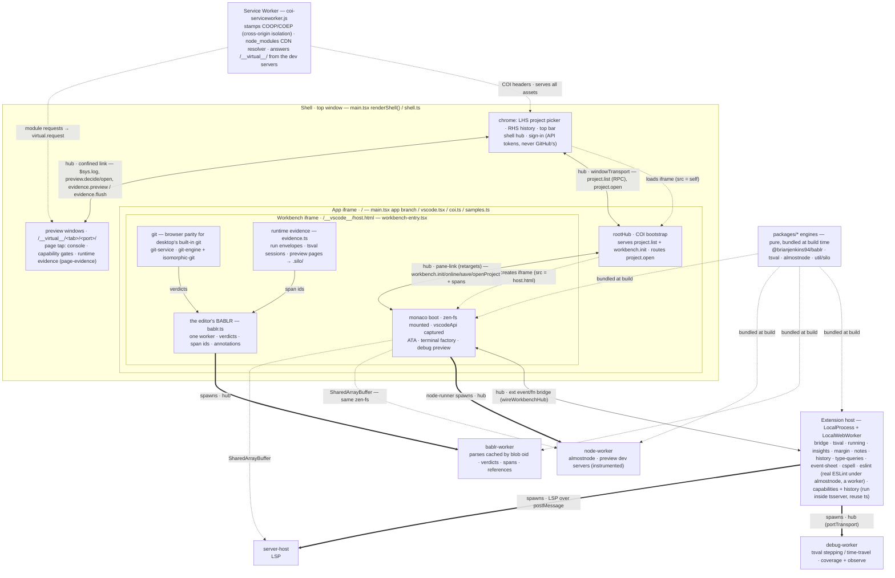

# editor — architecture & "where does this code go?"

The editor spans ~six runtime **realms** (separate JS execution contexts). Most "where should this live?"
confusion is really "which realm does it need to run in?" — so this doc is the realm map plus a placement
procedure. What an extension may plug into is *Extension points*, below, and the capability overlay is
*Capabilities*.

## The two axes behind every placement decision

1. **Which realm?** — decided by *what the code needs to touch* (DOM? the vscode API? the workspace filesystem?
   tsserver's Program? heavy CPU?). Placement follows the CAPABILITY the code needs, not the feature it belongs to.
2. **Engine or binding?** — a pure, reusable **engine** (fewest host deps, node-testable) kept separate from a thin
   **binding** that maps it into one realm. This axis cuts across every realm.

**Portability caveat — the tie-breaker on Axis 1.** The **workbench iframe** realm is *our* custom
monaco-vscode-api boot; it does **not** exist in desktop VS Code, and neither do the browser shims that recreate
what desktop ships built-in. Split product functionality by one question: **does desktop VS Code already provide
this?**

- **Browser-parity shim** — desktop gives it to you out of the box; we only rebuilt it because the browser lacks the
  underpinning (e.g. **git SCM**: desktop's bundled git extension provides it, but that shells out to a `git` binary
  the browser has none of). This is a **browser-host concern**. It is *not* meant to port (desktop uses its own), so
  keep it browser-side — the workbench realm, or a browser-only extension — and do **not** dress it up as a portable
  product extension (no `extensions/git/`; that would imply we ship SCM to desktop, which we don't).
- **Novel functionality** — desktop does *not* provide it (e.g. the capability overlay; the **BABLR cosmetic/
  semantic classifier**). *This* is what should be **portable** → a self-contained **extension** (ext host,
  `vscode.workspace.fs`, spawning its own workers) that runs on both our browser host and desktop VS Code, layered
  on top of whatever SCM/host is present. The `capabilities` extension is the model.

Reserve `workbench-entry` (the workbench realm) for host-**boot glue** proper (the monaco `boot()` call, mounting
zen-fs, the terminal process factory, registering extensions) — and for browser-parity shims that have nowhere more
natural to sit. **The BABLR classifier** was welded into our browser git SCM; since 2026-10-15 its verdict is the
`cosmetic` extension's badge (a file decoration), on `editor.annotations.classify` (core's BABLR worker and its parse
cache) and the editor's git commands — decoupled from the git service, which no longer classifies (the review,
`git.review` in git-review.ts, joins its verdict to git's hunks at the edge). Reading changes
from desktop's built-in git, and a BABLR of its own there, are what's left for it to run on desktop.

## The realms

| Realm | Entry / key files | Can access | What lives here |
|---|---|---|---|
| **Shell** (top window) | `shell/`: `main.tsx`'s `renderShell()` branch → `shell/shell.tsx`, `shell/git-panel.tsx` | DOM, the shell hub; the sign-in (`shell/session.ts`: a DPoP key and the API's tokens — GitHub's token stays in packages/api) | Surrounding chrome: LHS project picker, top bar, and the RHS **git review panel** (`shell/git-panel.tsx` — GitHub-Desktop-style changes/diff/commit, a pure hub consumer of `git.*`). Loads the app in an iframe pointing back at the same page. |
| **App iframe** (`/`) | `app/`: `main.tsx`'s app branch, `app/coi.ts`, `app/vscode.tsx`, `app/samples.ts`, `app/tools/` (the tab's MCP tools) | DOM, `rootHub`, COI bootstrap | Boots the workbench iframe (the preview windows live in the shell; this realm runs their backend — see below) and links it into `rootHub` over the retargeting pane-link transport; serves `project.list` + `workbench.init`, routes `project.open` → `openProject`. Owns the top of the hub tree. |
| **Workbench iframe** (`/__vscode__/host.html`) | `workbench/`: `workbench-entry.tsx`, `workspace-fs.ts`, `ata.ts`, `terminal/`, `node-runner.ts`, `git-service.ts` | **the vscode API *and* zen-fs** (both live here), DOM — but it is OUR boot, so nothing here ports to desktop VS Code | Host-boot glue: the monaco `boot()` (VS Code's full workbench lays itself out — its own activity bar, sashes, movable views and remembered layout, minus the menu bar and title bar, which the shell's chrome replaces), mounting zen-fs, capturing the vscode API, the terminal process factory, registering extensions, spawning the workers. *(Core lives here too: the git engine and service — legitimate browser parity for desktop's built-in git; VS Code's Source Control view on it is the source-control extension's, through the `editor.git.*` commands — the editor's BABLR (`bablr.ts`: one worker, its parses cached by blob oid, answering the git panel's verdicts, runtime evidence's span ids, and extensions' annotation references and resolutions), and runtime evidence (`evidence.ts`: each run's envelope, and what tsval sessions and preview pages observed, folded into `.silo/`). The cosmetic classifier the git service asks is the part that should become a standalone extension — see the known debt above.)* |
| **Extension hosts** (`LocalProcess`, sharing the workbench's realm; `LocalWebWorker`, a worker) | `extensions/<name>/extension.ts`, `extensions/<name>/ts-plugin.js` | the vscode API (files through `vscode.workspace.fs`) — **no DOM, no zen-fs**; the hub only in `bridge` | One extension per feature (*Extensions: which one, which host*, below). `LocalProcess`: `bridge` (core's vscode API is its, and it's the only extension on the hub: every debugger's editor-api events and capability stops, the workspace runtime, tasks, Source Control, core's BABLR to extensions as `editor.annotations.*`) and `tsval`, which needs what only that host has. `LocalWebWorker`: everything else — `running`, `insights`, `margin` (the Margin, from the run contract's events), `cosmetic` (a change's cosmetic mark), `notes`, `history`, `type-queries`, `event-sheet`, `cspell`, `eslint`, `capabilities`, and VS Code's own TypeScript extension. `capabilities` and `history` also run a plugin *inside tsserver*, reusing its `ts` and its Program; `eslint` runs real ESLint under almostnode in a worker of its own (below). |
| **Workers** (`dist/lsp/*`) | `workers/` for core's (spawned from the workbench realm: `node-worker`, `provoke-worker`, `bablr-worker`); an extension's own sit in its folder (`extensions/tsval/debug-worker.ts`, `extensions/cspell/server-host.ts`, `extensions/event-sheet/recognizer-worker.ts`) — only what is messaged in | nothing host-y | Heavy/blocking compute, off the UI thread: `node-worker` (almostnode: dev servers and previews), `bablr-worker` (the editor's BABLR, for `bablr.ts`: parses cached by blob oid in its own IndexedDB; cosmetic verdicts, span ids for runtime evidence, annotation references and resolutions), `debug-worker` (tsval stepping a program, almostnode for its packages; top-level, from the `LocalProcess` host), and — nested in the `LocalWebWorker` host, as any of its extensions' workers are, each named by its extension (`ext:<extension>/<worker>`) — VS Code's two tsservers, the cspell server (almostnode running cspell), eslint's worker (`extensions/eslint/worker.ts`: almostnode running real ESLint with the workspace's `eslint.config.*` or else the preset, from the toolchain the build traces and packs — `build/eslint-toolchain.ts` → `lsp/eslint-toolchain.tgz` — over the workspace through the workspace runtime), the event sheet's recognizer, and the capabilities extension's package worker (`extensions/capabilities/packages-worker.ts`: each dependency's tarball read for the baseline, started per sync). |
| **Packages** (`packages/*`, plain node) | nothing host-y — pure | — | Engines: `@brianjenkins94/bablr` (upstream BABLR and our grammar, `bablr-language-ts`, bundled: `cstSpans`, span ids, `reidentify`/`follow`, `classifyChange`), `tsval` (the interpreter, and its `observe` hook), `almostnode` (the node runtime and previews' dev server, which instruments workspace modules for runtime evidence), `playwright` (our own Playwright: a locator engine on a page's DOM, and `Page`/`Locator`/`expect` over it — the shell runs its engine on a preview's page, the debug worker its API for `@playwright/test`), `util/silo` (the shared policy model, runtime evidence and span annotations: pure models and layouts), and tsval's `capability-calls` (how a call is told for a capability), which the capabilities plugin's canary is built with. Built/aliased into the realms above. |

There is also a **service worker** (`coi-serviceworker.js`, registered by `app/coi.ts`): one per origin, it stamps the
COOP/COEP headers that make every realm cross-origin-isolated (SharedArrayBuffer) on a static host, and resolves the
CDN `node_modules` overlay. Not a place you put feature code. It sits at the package root beside `index.html` and
`main.tsx`, because a service worker's URL is its scope.

**The folders are the realms.** A file's folder says which realm runs it: `shell/`, `app/`, `workbench/`, `workers/`,
`previews/` (what runs inside a preview's own pages: the page and worker taps, page evidence), and `extensions/<name>/`
(that extension's host, and the workers it spawns). What more than one realm runs is in `shared/` (the architecture
model, `virtual-path`, `workspace-changes`, `theme`, almostnode on the workspace, as every worker that runs a program has it: `zenfs-vfs`, `workspace-runtime`; `playground-link`), and the
shapes one realm serves and another reads (`runs`, `git`); build-time Vite plugins are in `build/`. What an *extension*
imports of core's is editor-api's, not `shared/`'s — the `.silo/` stores (`./evidence`, `./policy`, `./effects`), run
classification (`./lifecycle`), profiles (`./cpuprofile`), the gated realm (`./gated-eval`), worker failures
(`./failures`), a preview's reports (`./recorded`), the network probes (`./probes`), almostnode over the runtime's
files (`./runtime-vfs`) — so an extension passes *Features as extensions*' test (below). One exception, decided: tsval, the
editor's own debugger, mounts the workspace's buffer as core does (`zenfs-vfs`, `workspace-runtime`; *Extension points* 2).
Lint holds the line (`no-restricted-imports`, the root `eslint.config.js`): a relative import that climbs into another
realm's folder — or, from an extension, another extension's — is an error. Only `workbench-entry` reaches into
`extensions/`, to register them; `main.tsx`, `build.ts`, `dev.ts` and the tests may reach anywhere. What a debugger's worker needs of a run — the values recorder,
recorded values, the gate's verdict — is editor-api's (*Extension points*), so any debugger imports the same.

## Extensions: which one, which host

Two separate questions, and the second is mechanics, not features.

**Is it its own extension?** Yes — one per feature, using the public vscode API only, so it could ship to desktop VS
Code. A feature split across two extensions is a smell; two features in one extension is one too.

**Which host?** `LocalWebWorker`, unless it needs something only the `LocalProcess` host has:

| needs | why only `LocalProcess` | who |
|---|---|---|
| the hub | the hub is core's, and one extension is the way across (`bridge`); feature extensions get no hub, so subscribers don't spread to wherever is convenient | `bridge` |
| the workspace runtime — the workspace's `SharedArrayBuffer` and a runtime link per worker | `bridge` provides it (`workspaceRuntime()`, editor-api) in its own host; an extension's `exports` don't cross hosts | `tsval` |
| top-level workers | that host shares the workbench's thread, so a worker it starts isn't nested in an extension-host worker | `tsval`'s debug workers |

And one rule pulls the other way: **a TypeScript Program means a tsserver plugin, and a plugin means `LocalWebWorker`.**
VS Code's TypeScript extension finds plugins through `vscode.extensions.all`, which only sees its own host, and that host
is `LocalWebWorker`. A plugin runs inside tsserver with tsserver's own `ts` and its Program — every source file, parsed
and checked, unsaved edits included — reached from its extension by `typescript.tsserverRequest` (`_`-prefixed
commands). That's how `capabilities` and `history` are built. eslint was too, for a while (b29e2a8 took it out of the old
pod of language servers, which had bundled a second TypeScript); since 2026-10-14 it runs real ESLint under almostnode
in a worker of its own instead — typescript-eslint needs TypeScript's classic API, which tsserver won't host past
TypeScript 7, and under almostnode its plugins run as Node runs them, where the bundle in tsserver had run few of them.

A Node program that needs neither the hub nor the workspace runs in a worker of its own extension, in `LocalWebWorker`,
under its own almostnode: `cspell` (its bootstrap holds the client's first messages until the server listens — a classic
bootstrap's script is done at once, so they'd arrive before it does).

### Two libraries that aren't places

- **almostnode** is Node, emulated — a library each worker that runs Node code creates its own instance of: `node-worker`
  (dev servers), `debug-worker` (a program's packages), the cspell server. Nothing shares an instance.
- **TypeScript** comes as two copies. VS Code's is inside its tsservers, and our plugins borrow it. Ours is the
  `lsp/typescript-*.js` chunk that `debug-worker`, `node-worker` (through almostnode) and the recognizer import: one file
  to download, but each worker that imports it holds its own instance.

## Cross-realm communication

- **hub** (`@brianjenkins94/hub`) — the composed message tree for *everything*, including the workbench boot
  handshake: pub/sub + RPC (`createRpcClient` / `serve`). Shape today: shell ↔ app over `windowTransport`; app
  `rootHub` ↔ workbench hub over the **pane-link** transport (`pane-link.ts`) — a `windowTransport` variant that
  *retargets* to the pane's live window so it survives a pop-out; workbench ↔ extension bridge over the bridge's exported
  event/function bridge; bridge ↔ its workers over `portTransport`. A message only crosses a link if the far side
  subscribed, so each realm runs standalone. The app↔workbench boot handshake is just hub messages on that link:
  the pane requests `workbench.init` (RPC, retried until interest settles), then publishes `workbench.online` /
  `workbench.save`, and the host publishes `workbench.openProject`. (This folded the old separate `pane-bus` + a
  dedicated `MessagePort` into one hub link; hub's `hello` handshake covers the lossy-window race the port guarded.)
- **plain postMessage** — only where the hub can't or mustn't go: a protocol dictated by someone else (LSP to
  `server-host`), or a realm that must stay bare (the capability-gated eval sandbox). Every other worker — even a
  single-purpose one like `bablr-worker` — joins the tree with its own hub (`worker-hub.ts`) and `serve`s its
  methods: calls get timeouts, cancellation and worker-failure handling from the hub instead of a hand-rolled
  id→pending map, show up by name on the live architecture view, and can be called from anywhere in the tree.
- **shared memory** — the workspace filesystem (below). No messages at all, so the live view observes it by wrapping
  each realm's `/workspace` mount (`architecture-zenfs.ts`).

### The live preview, end to end

`npm run dev` in the terminal runs the workspace's `vite` script → the terminal publishes `preview.open` → root
(`preview.ts`) asks the node worker to `preview.start` almostnode's in-browser Vite dev server on that port and
publishes `preview.ready` → the shell (`shell-preview.ts`) opens a window whose iframe loads
`<base>/__virtual__/<tab>/<port>/`. Every request from that iframe is answered by the **service worker**, which calls
the dev server over the hub (`virtual.request.<tab>` to that tab's root, which asks its node worker). The previewed app's bare imports resolve to
**esm.sh** and pass through the service worker. When anything changes the workspace (a save, a git checkout, a
script), the dev server hears it on `workspace.changed` and emits an HMR update on `preview.hmr.<port>` → the shell
posts it into the iframe. Back up the other way, everything rides the window's hub: the dev server inlines a tap as
each page's first script (`page-tap.ts`), and a window's top frame holds its one hub into the editor — the tap's, which
the shell links (confined: `previewAppPermissions`) and names as the window. Its console and errors go out on
`$sys.log`, WebSocket/WebRTC capability requests as `preview.decide` and new windows as `preview.open` (the shell knows
the window from the link, never from what the page says); frames nested in the window use the top frame's tap
directly, and the app's own hub, if it has one, joins through it (observability's `linkPreviewHost`). A worker the page
starts joins the window's hub through the page: the page tap hands it a port as its first message (`WORKER_OFFER`), and
its tap (`worker-tap.ts`) sends its records and capability questions through the page's (`tap.worker.log`,
`tap.worker.decide`). A run's own file calls go through the editor instead, by the workspace runtime's mailbox
(*Extension points* 2), gated there.
On the live diagram: `preview:<port>` (the iframe) and `vite:<port>` (its dev server) come and go with the preview.

**What a preview's code does is runtime evidence** (RUNTIME-EVIDENCE.md, the third slice). As a preview starts, the
dev server asks core how much to instrument (`evidence.level`, the `silo.evidence.previews` setting) and compiles each
workspace module through almostnode's instrumenting transformer, naming each version by its source's blob oid. The page
tap carries the page runtime (`page-evidence.ts`), which counts what the modules report, by file and version, so a hot
update's re-import counts on. Each page reports its totals on `evidence.preview` — every 10 s while they change, on a hot
update, on `pagehide`, and when core asks (`evidence.flush`, which the `vite` command sends before the windows close).
Core (`evidence.ts`) finds the run by the window's port, asks the dev server for each new version's source
(`preview.version`), and when the run ends folds every version into the files' evidence in `.silo/`.

**A server has as many windows as the user opens**, like browser tabs onto one dev server — and no address bar. A
window's "new window" button opens another onto the same server; so does the app itself, opening one of its pages as
a new window (`window.open`, a `target="_blank"` link): the tap hands that up (`preview.open`) instead of letting it
leave the editor as a browser tab. Each window is its own page — its own reload, DevTools, capability prompts and hub
link — named `preview:<port>` (the port's first) or `preview:<port>~<n>`; HMR reaches all of them; closing one closes
just it, and closing a server's last window (or Ctrl-C on `vite`) stops the server. An app's hubs name themselves (every
window of one app has a `page`), so the edge names them: the shell renames each window's observability as it enters
the editor's tree (observability's `scopedTransport`) — the window's hub (its tap's) IS `preview:<port>~<n>`, the app's
hubs `preview:<port>~<n>/<hub>` — never two `page`s merged. Where each runs is reported, not guessed: a frame's realm names
its parent's address, and the page's tap tags each worker it starts with its page and window (its URL's hash), so a
worker sits under the realm that started it and its logs and capability requests go to its window.
Two ports are two servers; in the editor they share one origin (ports are paths under `/__virtual__/`), which a desktop
wouldn't — so an app can't rely on origin-scoped state crossing ports.

**The service worker keeps no state.** The browser stops an idle service worker and starts a fresh global on the
next event, so it remembers nothing between requests: it asks the page for a hub link whenever it starts
(`sw-needs-hub`), and asks the bridge for every capability decision (the bridge maps a preview's port to its run). Its
calls wait for a responder (`waitForResponderMs`) instead of publishing into an unlinked hub, and the capability gate
**fails closed**: with no decider reachable, a preview's data fetch gets a 403 and a node script's write is denied.

**One service worker serves every tab.** It links each tab's root hub separately and **non-transit** (a hub link
option: nothing passes between two non-transit links), so tabs are never joined through it, and it addresses what it
asks to the tab it's for — `virtual.request.<tab>`, `capability.decide.<tab>`, which only that tab's root answers,
from its own tree. The tab comes from the preview's URL, or, for a node script's decision, from the node worker (its
URL carries the tab). debug-mcp links every open tab the same way (non-transit), for the same reason.

**The preview is not a security boundary.** Its iframe is same-origin with the editor and unsandboxed, by necessity:
a sandboxed (opaque-origin) frame isn't controlled by the service worker, so `/__virtual__/` would never reach the dev
server (verified: `sandbox="allow-scripts"` renders nothing), and it would lose cross-origin isolation, so no
`SharedArrayBuffer` for previewed apps. Adding `allow-same-origin` back makes the sandbox escapable. So a previewed app
can reach `window.parent` (the editor's DOM, storage, hub), and the capability gate guards against accidents, not
hostile code. A real boundary needs the preview on a separate origin with its own service worker.

### The workspace filesystem (zen-fs)

The workbench creates a 64 MB `SharedArrayBuffer` zen-fs store (`workspace-fs.ts`) mounted at `/workspace` and hands
the buffer to the node worker (over the hub, `workspace.buffer`); the provoke child gets it directly, and a debug run
in its launch (the bridge holds it). All of them read and write the same bytes under an Atomics lock.

Shared memory tells nobody anything, so there is **one change stream** (`workspace-changes.ts`): each realm watches its
own mount's mutating store operations and reports them, batched, as `workspace.changed`. The workbench persists every
change to IndexedDB (`workspace-fs`, 500 ms debounce — it copies the path's current state, so a deleted or renamed tree
goes with it) and announces it to VS Code as a file-change event (except `.git/**`, whose writes the git watchers
cause); the node worker's dev servers hot-reload from it. So a write is saved and seen the same way whoever made it:
the editor's provider, isomorphic-git, the terminal, a node script. The live view labels workbench operations by caller
(`vscode ·`, `direct ·`, `seed ·`, `restore ·`, `persist ·`).

### The metrics plane

Beside the logs (`$sys.log`) and the architecture (`$sys.arch`), each context can publish numbers once a second on
`$sys.metrics.<source>` (observability's `reportMetrics`: named gauges, read at each sample). The workbench reports
memory by realm (`measureUserAgentSpecificMemory`, about every 30 s: it waits for a garbage collection), the workspace's fill (read from the zen-fs superblock),
its time in long animation frames, hub traffic and the origin's storage; the shell reports its own long frames
(`editor-metrics.ts`). The bridge keeps the last five minutes of each and serves them to VS Code as the
`editor.metrics.read` command, which the insights extension's monitor (status bar + a view of sparkline cards) reads —
so the monitor, like the rest of insights, uses nothing but VS Code's API. Memory is named by realm: the editor's own by
path, and the `blob:` workers (the web worker extension host, TypeScript's servers, the language servers, monaco's
workers) by the architecture probes, which put each worker's URL on its node — a probed worker reports its own in its
`hello`.

The host page reports `spans`: every context's timed spans (`→ cdn` / `← cdn (12ms)`) as rates, errors and latencies per
`source/name` — ended per second over the last 10 s, how many had an error logged inside them, p50/p95, and how many are
open — computed from the records its collector already receives, so no subsystem does anything to be measured. A
failing operation (a CDN fetch, a type acquisition) shows in the monitor's status bar while it fails. debug-mcp keeps
five minutes of each tab's plane too: `metrics_query` summarizes any series over a window (latest, min, max, mean, and
the readings when asked), the same numbers the monitor draws.

### Side channels (off the hub, on purpose)

Everything that can ride the hub does. What doesn't, and why:

- **the capability decide route** — a node script's `writeFileSync` must block, so it asks with a synchronous XHR the
  service worker answers; the SW then asks the bridge over the hub.
- **the cspell language server** — the cspell extension's own worker, spoken to over LSP on its worker port; it reads
  nothing of the workspace (documents come over LSP), so it has neither the hub nor the buffer.
- **a preview's HMR posts** — HMR updates go into the iframe as plain posts. Everything else of a preview window —
  its workers' records and questions too, through its page's tap — rides its hub link, confined (the previewed app is
  untrusted: `previewAppPermissions`).

## Diagram — realms & channels

Edge styles: **solid arrows** = live message channels; **thick arrows** = a realm spawning a worker; **dotted arrows**
= frame creation, shared-memory, service-worker serving, and build-time bundling. Nesting = iframe containment
(shell ▸ app ▸ workbench).

## Discovered, not declared

The live architecture view and the diagram below show the editor as it is, and stay that way without anyone keeping
them: everything on them is discovered from the running editor, and the only things declared are the rules it's held to.
(Built 2026-10-04 to 10-19; why: a day's work all inside existing realms changed nothing on a realm-level view, and a
hand-kept model of 96 subject families had drifted.)

What's discovered, and how, with no source read:

- **Contexts, links, messages, side channels.** Every hub announces itself and its links on `$sys.arch` (observability's
  reporter), counting each message's subject, direction, size and kind per link; probes report network requests,
  workers, window messages, `MessagePort`s and each realm's `/workspace` operations, labelled by caller.
- **Extensions, by their own API.** The build hands every bundled extension a `vscode` whose `commands` are counted
  (extensions/command-tap.ts, build.ts's `commandTap`); each host sends its totals to the bridge
  (`editor.arch.commands`), which puts `ext:<name>` nodes and `cmd …` edges on the view. Commands nobody bundled
  registered belong to `ext:vscode`; an extension installed from the gallery isn't tapped.
- **Stores, by what's written.** The zen-fs probe records each read, write, create, unlink and rename in a tool's
  dot-directory, paths of one shape collapsing to one store (`.silo/evidence/<user>/<env>/<file>.jsonl`; a listing or a
  stat isn't content; shared/architecture-zenfs.ts `storeShape`); the command tap counts `workspace.fs` the same way;
  the IndexedDB probe names each database. `discoveredStores` reads them back with their writers and readers.
- **Flows, by causality.** Every hub message has an `id`, and one sent while a hub runs another's handlers names it as
  its `cause`; an RPC call takes its cause when it's made, a reply names its call, and a call a queue defers names what
  it was queued for (`handlingMessage`, RpcRequestOptions' `cause`). The browser has no async context, so where the
  trace is lost, observability's `flowsOf` links a message to the last one its sender received within 50 ms, marked
  inferred.
- **Components within a realm.** The hub takes a stack trace once, as a handler subscribes, and keeps the first named
  function outside the hub (`startBablr`, `installEvidence`); `componentsOf` groups a hub's subscriptions by it, or by
  namespace where a minified build kept no names (three characters or fewer count as none).
- **Features, by clustering.** Subjects that share a namespace or keep turning up in the same flows; the view's feature
  picker lights one and fades the rest.

What can't be: what never ran (a static scan is its later complement: edges no run has seen are untested paths);
intent (which way a subject may travel — a rule); a component's insides; the file and line.

So `architecture-model.ts` keeps only the rules — containment, the hub tree, each family's direction, each direct
channel's reason, what a preview window's link allows — with a sentence of intent where a name doesn't say it. The
family descriptions, the stores table and the declared diagram went. Discovered edges are their own kind
(`declaredBetween` says `discovered`), drawn green, never red. Since 2026-10-19 the view is the canvas, the feature lens
and each hub's components as rows in its box (a hub link's messages a thin line to the component subscribed); its side
panel went, and review is debug-mcp's `architecture_state` (its `violations`, or a channel's traffic with `channel`)
and observability's `flowsOf`, which the tour checks.

Decided 2026-10-04: components by namespace refined by registering function (not a child hub per component); flows by
traces where the hub can, timing elsewhere, marked inferred; stores and databases discovered; this file's diagram
rendered from the tour and checked by the architecture workflow; features by namespace merged by co-occurrence; the
model reduced to rules; a static scan later.

## Observed architecture (generated by the tour)

The diagram above is the narrative, and says what can't be seen (what's bundled at build time). This one is what the
**architecture tour** (its shards, `test/architecture-tour-*.mjs`, together) saw the editor do — every context, extension and store, and what
joined them; then the stores, with who writes and who reads each; then each hub's components — rendered by
`tourDiagram()` with nothing declared but where things run (*Discovered, not declared*, above). Instances read as one of a kind
(`Preview :*`), and there are no counts, so the same tour renders the same block. A local run of the tour (then
`test/architecture-diagram.mjs`, which merges what its shards saw) rewrites it; the architecture workflow re-runs it and
fails when it differs — so a change that adds a part, a channel or a store
shows up here, in the same commit. Hub links are `<==>`, other channels `<-.->` (labelled by their protocol, or
`undeclared`), an extension's commands `commands`, and a store's edges say whether it's read or written.

What the model in `architecture-model.ts` still declares is the rules: which way each subject family may travel, why a
direct channel isn't a hub link, what a preview window's link allows, and where each context runs. The **live
architecture view** (*Developer: Open Live Architecture Diagram*) checks what it observes against them.

```mermaid
flowchart LR
  subgraph c_shell["Shell"]
    n_shell["Shell"]
    subgraph c_previews["Preview windows"]
      n_preview__["Preview :*"]
    end
  end
  subgraph c_app["App iframe"]
    n_root["Root"]
  end
  subgraph c_workbenchIframe["Workbench iframe"]
    n_webview_markdown_preview["markdown.preview"]
    subgraph c_workbench["Main thread"]
      n_bridge["Bridge"]
      n_ext_bridge["bridge"]
      n_ext_tsval["tsval"]
      n_ext_vscode["VS Code"]
      n_exthost_LocalProcess_0["Local extension host"]
      n_workbench["Workbench"]
    end
    subgraph c_editorWorkers["Editor workers"]
      n_worker_TextMateWorker["TextMate worker"]
      n_worker_editorWorkerService["Editor worker"]
      n_worker_perfBaseline["Perf baseline worker"]
    end
    subgraph c_workers["App workers"]
      n_bablr["BABLR worker"]
      n_node["Dev-server worker"]
      n_provoke["Provoke worker"]
      n_server__["server:*"]
      n_vite__["Vite dev server :*"]
    end
    subgraph c_debugWorkers["Debug workers"]
      n_debug_worker["Debug worker"]
    end
    subgraph c_extHostIframe["Extension host iframe"]
      n_exthost_iframe["Iframe relay"]
      subgraph c_extHostWorker["Web worker extension host"]
        n_eslint["ESLint worker"]
        n_ext_capabilities["capabilities"]
        n_ext_capabilities_packages["packages"]
        n_ext_cosmetic["cosmetic"]
        n_ext_cspell_cspell["cspell"]
        n_ext_eslint["eslint"]
        n_ext_event_sheet["event-sheet"]
        n_ext_event_sheet_recognizer_js["recognizer.js"]
        n_ext_history["history"]
        n_ext_insights["insights"]
        n_ext_json_language_features_jsonServerMain_js["jsonServerMain.js"]
        n_ext_margin["margin"]
        n_ext_markdown_language_features_serverWorkerMain_js["serverWorkerMain.js"]
        n_ext_notes["notes"]
        n_ext_running["running"]
        n_ext_source_control["source-control"]
        n_ext_typescript_language_features_TS_semantic_server["TS semantic server"]
        n_ext_typescript_language_features_TS_syntax_server["TS syntax server"]
        n_ext_vscode_eslint_eslint["eslint"]
        n_exthost_LocalWebWorker_0["Worker extension host"]
      end
    end
  end
  subgraph c_browserChannels["Browser channels"]
    n_channel_vscode_indexedDB_vscode_userdata_changes["vscode.indexedDB.vscode-userdata.changes"]
    n_channel_vscode_web_state_db_global["vscode-web-state-db-global"]
    n_channel_vscode_web_state_db_global_shared["vscode-web-state-db-global-shared"]
  end
  subgraph c_stores["Stores"]
    n_store__git__file_[".git/&lt;file&gt;"]
    n_store__git_objects____file_[".git/objects/…/&lt;file&gt;"]
    n_store__git_refs____file_[".git/refs/…/&lt;file&gt;"]
    n_store__silo__file__json[".silo/&lt;file&gt;.json"]
    n_store__silo__gitattributes[".silo/.gitattributes"]
    n_store__silo__gitignore[".silo/.gitignore"]
    n_store__silo_capabilities__file__json[".silo/capabilities/&lt;file&gt;.json"]
    n_store__silo_evidence____file__json[".silo/evidence/…/&lt;file&gt;.json"]
    n_store__silo_evidence____file__jsonl[".silo/evidence/…/&lt;file&gt;.jsonl"]
    n_store__silo_local____file__bin[".silo/local/…/&lt;file&gt;.bin"]
    n_store__silo_local____file__jsonl[".silo/local/…/&lt;file&gt;.jsonl"]
    n_store__silo_local__file__json[".silo/local/&lt;file&gt;.json"]
    n_store__silo_notes____file__jsonl[".silo/notes/…/&lt;file&gt;.jsonl"]
    n_store__silo_policy__file__json[".silo/policy/&lt;file&gt;.json"]
    n_store__silo_runs__file__jsonl[".silo/runs/&lt;file&gt;.jsonl"]
    n_store__vscode__file__json[".vscode/&lt;file&gt;.json"]
  end
  subgraph c_sharedMemory["Shared memory"]
    n_zenfs["Workspace (zen-fs)"]
  end
  subgraph c_browser["Browser"]
    n_idb["IndexedDB"]
  end
  subgraph c_network["Network (service worker)"]
    n_debug_mcp["debug-mcp"]
    n_net_api_deps_dev["deps.dev"]
    n_net_esm_sh["esm.sh"]
    n_net_lighter_codehike_org["Code Hike"]
    n_net_open_vsx_org["Open VSX"]
    n_net_origin["Page origin"]
    n_net_registry_npmjs_org["npm registry"]
    n_net_unpkg_com["unpkg"]
    n_sw["Service worker"]
  end
  n_bablr <-.->|"IndexedDB"| n_idb
  n_bablr <==> n_workbench
  n_bridge <==> n_debug_worker
  n_bridge <==> n_workbench
  n_channel_vscode_indexedDB_vscode_userdata_changes <-.->|"VS Code user-data sync"| n_workbench
  n_channel_vscode_web_state_db_global <-.->|"VS Code storage sync"| n_workbench
  n_channel_vscode_web_state_db_global_shared <-.->|"VS Code storage sync"| n_workbench
  n_debug_mcp <==> n_root
  n_debug_worker <-.->|"in-realm calls"| n_server__
  n_eslint <-.->|"HTTP"| n_sw
  n_eslint <==> n_workbench
  n_ext_bridge -->|"reads"| n_store__git__file_
  n_ext_bridge -->|"reads"| n_store__silo__file__json
  n_ext_bridge -->|"reads"| n_store__silo__gitignore
  n_ext_bridge -->|"reads, writes"| n_store__silo_capabilities__file__json
  n_ext_bridge -->|"reads, writes"| n_store__silo_local__file__json
  n_ext_bridge -->|"reads, writes"| n_store__silo_policy__file__json
  n_ext_bridge <-.->|"commands"| n_ext_capabilities
  n_ext_bridge <-.->|"commands"| n_ext_cosmetic
  n_ext_bridge <-.->|"commands"| n_ext_event_sheet
  n_ext_bridge <-.->|"commands"| n_ext_history
  n_ext_bridge <-.->|"commands"| n_ext_insights
  n_ext_bridge <-.->|"commands"| n_ext_margin
  n_ext_bridge <-.->|"commands"| n_ext_notes
  n_ext_bridge <-.->|"commands"| n_ext_running
  n_ext_bridge <-.->|"commands"| n_ext_tsval
  n_ext_bridge <-.->|"commands"| n_ext_vscode
  n_ext_capabilities -->|"reads"| n_store__git__file_
  n_ext_capabilities -->|"reads"| n_store__silo_runs__file__jsonl
  n_ext_capabilities -->|"reads, writes"| n_store__silo__file__json
  n_ext_capabilities -->|"reads, writes"| n_store__silo_policy__file__json
  n_ext_capabilities <-.->|"commands"| n_ext_capabilities
  n_ext_capabilities <-.->|"commands"| n_ext_margin
  n_ext_capabilities <-.->|"commands"| n_ext_vscode
  n_ext_capabilities_packages <-.->|"extension defined (LSP, tsserver)"| n_exthost_LocalWebWorker_0
  n_ext_cosmetic <-.->|"commands"| n_ext_vscode
  n_ext_cspell_cspell <-.->|"extension defined (LSP, tsserver)"| n_exthost_LocalWebWorker_0
  n_ext_event_sheet <-.->|"commands"| n_ext_vscode
  n_ext_event_sheet_recognizer_js <-.->|"extension defined (LSP, tsserver)"| n_exthost_LocalWebWorker_0
  n_ext_history -->|"reads"| n_store__silo_evidence____file__json
  n_ext_history -->|"reads"| n_store__silo_local____file__jsonl
  n_ext_history -->|"reads"| n_store__silo_runs__file__jsonl
  n_ext_history -->|"reads, writes"| n_store__silo__file__json
  n_ext_history <-.->|"commands"| n_ext_vscode
  n_ext_insights -->|"reads"| n_store__silo_evidence____file__jsonl
  n_ext_insights -->|"reads"| n_store__silo_local____file__jsonl
  n_ext_insights <-.->|"commands"| n_ext_vscode
  n_ext_json_language_features_jsonServerMain_js <-.->|"extension defined (LSP, tsserver)"| n_exthost_LocalWebWorker_0
  n_ext_margin -->|"reads"| n_store__silo__gitattributes
  n_ext_margin -->|"reads"| n_store__silo__gitignore
  n_ext_margin -->|"reads"| n_store__silo_evidence____file__jsonl
  n_ext_margin -->|"reads"| n_store__silo_local__file__json
  n_ext_margin -->|"reads, writes"| n_store__silo_local____file__jsonl
  n_ext_margin <-.->|"commands"| n_ext_running
  n_ext_margin <-.->|"commands"| n_ext_vscode
  n_ext_margin <-.->|"the workspace runtime's hub link (editor-api's observeExtension)"| n_workbench
  n_ext_markdown_language_features_serverWorkerMain_js <-.->|"extension defined (LSP, tsserver)"| n_exthost_LocalWebWorker_0
  n_ext_notes -->|"reads"| n_store__git__file_
  n_ext_notes -->|"reads"| n_store__silo__gitattributes
  n_ext_notes -->|"reads"| n_store__silo_evidence____file__jsonl
  n_ext_notes -->|"reads, writes"| n_store__silo_notes____file__jsonl
  n_ext_notes <-.->|"commands"| n_ext_vscode
  n_ext_running -->|"reads"| n_store__silo_local____file__jsonl
  n_ext_source_control <-.->|"commands"| n_ext_vscode
  n_ext_tsval -->|"reads"| n_store__git__file_
  n_ext_tsval -->|"reads"| n_store__silo_policy__file__json
  n_ext_tsval <-.->|"commands"| n_ext_vscode
  n_ext_typescript_language_features_TS_semantic_server <-.->|"extension defined (LSP, tsserver)"| n_exthost_LocalWebWorker_0
  n_ext_typescript_language_features_TS_syntax_server <-.->|"extension defined (LSP, tsserver)"| n_exthost_LocalWebWorker_0
  n_ext_vscode_eslint_eslint <-.->|"extension defined (LSP, tsserver)"| n_exthost_LocalWebWorker_0
  n_exthost_LocalProcess_0 <-.->|"RPCProtocol"| n_workbench
  n_exthost_LocalWebWorker_0 <-.->|"HTTP"| n_sw
  n_exthost_LocalWebWorker_0 <-.->|"RPCProtocol"| n_workbench
  n_exthost_iframe <-.->|"bootstrap handshake"| n_workbench
  n_idb <-.->|"IndexedDB"| n_workbench
  n_idb <-.->|"IndexedDB"| n_zenfs
  n_net_api_deps_dev <-.->|"HTTP"| n_sw
  n_net_esm_sh <-.->|"HTTP"| n_sw
  n_net_lighter_codehike_org <-.->|"HTTP"| n_sw
  n_net_open_vsx_org <-.->|"HTTP"| n_sw
  n_net_origin <-.->|"HTTP"| n_sw
  n_net_registry_npmjs_org <-.->|"HTTP"| n_sw
  n_net_unpkg_com <-.->|"HTTP"| n_sw
  n_node -->|"reads"| n_store__silo__file__json
  n_node <-.->|"in-realm calls"| n_vite__
  n_node <-.->|"zen-fs"| n_zenfs
  n_node <==> n_provoke
  n_node <==> n_workbench
  n_preview__ <-.->|"HTTP"| n_sw
  n_preview__ <==> n_shell
  n_provoke <-.->|"zen-fs"| n_zenfs
  n_root <==> n_shell
  n_root <==> n_sw
  n_root <==> n_workbench
  n_shell <-.->|"HTTP"| n_sw
  n_sw <-.->|"HTTP"| n_workbench
  n_sw <-.->|"HTTP"| n_worker_TextMateWorker
  n_webview_markdown_preview <-.->|"VS Code webview protocol"| n_workbench
  n_workbench -->|"reads, writes"| n_store__git__file_
  n_workbench -->|"reads, writes"| n_store__git_objects____file_
  n_workbench -->|"reads, writes"| n_store__git_refs____file_
  n_workbench -->|"reads, writes"| n_store__silo__file__json
  n_workbench -->|"reads, writes"| n_store__silo__gitattributes
  n_workbench -->|"reads, writes"| n_store__silo__gitignore
  n_workbench -->|"reads, writes"| n_store__silo_capabilities__file__json
  n_workbench -->|"reads, writes"| n_store__silo_evidence____file__json
  n_workbench -->|"reads, writes"| n_store__silo_evidence____file__jsonl
  n_workbench -->|"reads, writes"| n_store__silo_local____file__jsonl
  n_workbench -->|"reads, writes"| n_store__silo_local__file__json
  n_workbench -->|"reads, writes"| n_store__silo_notes____file__jsonl
  n_workbench -->|"reads, writes"| n_store__silo_policy__file__json
  n_workbench -->|"reads, writes"| n_store__silo_runs__file__jsonl
  n_workbench -->|"reads, writes"| n_store__vscode__file__json
  n_workbench -->|"writes"| n_store__silo_local____file__bin
  n_workbench <-.->|"WebWorker protocol / postMessage"| n_worker_TextMateWorker
  n_workbench <-.->|"WebWorker protocol / postMessage"| n_worker_editorWorkerService
  n_workbench <-.->|"WebWorker protocol / postMessage"| n_worker_perfBaseline
  n_workbench <-.->|"zen-fs"| n_zenfs
```

<!-- architecture-tour:begin -->

| Store | Written by | Read by |
| --- | --- | --- |
| `.git/<file>` | Workbench | Workbench, bridge, capabilities, notes, tsval |
| `.git/objects/…/<file>` | Workbench | Workbench |
| `.git/refs/…/<file>` | Workbench | Workbench |
| `.silo/.gitattributes` | Workbench | Workbench, margin, notes |
| `.silo/.gitignore` | Workbench | Workbench, bridge, margin |
| `.silo/<file>.json` | Workbench, capabilities, history | Dev-server worker, Workbench, bridge, capabilities, history |
| `.silo/capabilities/<file>.json` | Workbench, bridge | Workbench, bridge |
| `.silo/evidence/…/<file>.json` | Workbench | Workbench, history |
| `.silo/evidence/…/<file>.jsonl` | Workbench | Workbench, insights, margin, notes |
| `.silo/local/…/<file>.bin` | Workbench | — |
| `.silo/local/…/<file>.jsonl` | Workbench, margin | Workbench, history, insights, margin, running |
| `.silo/local/<file>.json` | Workbench, bridge | Workbench, bridge, margin |
| `.silo/notes/…/<file>.jsonl` | Workbench, notes | Workbench, notes |
| `.silo/policy/<file>.json` | Workbench, bridge, capabilities | Workbench, bridge, capabilities, tsval |
| `.silo/runs/<file>.jsonl` | Workbench | Workbench, capabilities, history |
| `.vscode/<file>.json` | Workbench | Workbench |
| `IndexedDB bablr` | BABLR worker | BABLR worker, Workbench |
| `IndexedDB silo-local` | Workspace (zen-fs) | Workspace (zen-fs) |
| `IndexedDB vscode-web-db` | Workbench | Workbench |
| `IndexedDB vscode-web-state-db--*` | Workbench | Workbench |
| `IndexedDB vscode-web-state-db-global` | Workbench | Workbench |
| `IndexedDB vscode-web-state-db-global-shared` | Workbench | Workbench |
| `IndexedDB workspace-fs` | Workspace (zen-fs) | Workspace (zen-fs) |

| Hub | Component | Serves and hears |
| --- | --- | --- |
| Bridge | bridge | `bridge.ready` |
| Bridge | capability | `capability.decide()`, `capability.record()`, `capability.recorded()` |
| Bridge | debug | `debug.breakpoints()`, `debug.command`, `debug.explore()`, `debug.launch`, `debug.session.*.decide()`, `debug.session.*.pace()`, `debug.session.*.setValue()`, `debug.session.*.state()`, `debug.session.*.stdin()`, `debug.session.*.step()`, `debug.session.*.stop()`, `debug.sessions()`, `debug.start()`, `debug.stop` |
| Bridge | margin | `margin.state()` |
| Bridge | node | `node.stdin.*` |
| Bridge | parse | `parse.status` |
| Bridge | production | `production.exit.*`, `production.launch`, `production.out.*` |
| Bridge | rules | `rules.state()` |
| Bridge | run | `run.effects()` |
| Bridge | runtime | `runtime.fs.attach()` |
| Bridge | stops | `stops.preview` |
| Bridge | tasks | `tasks.list()`, `tasks.run()` |
| Dev-server worker | preview | `preview.close`, `preview.provoke()`, `preview.start()`, `preview.stops()`, `preview.version()` |
| Dev-server worker | virtual | `virtual.request()` |
| Dev-server worker | workspace | `workspace.changed` |
| Root | capability | `capability.decide.*()`, `capability.record.*()` |
| Root | page_tools | `page_tools.*()` |
| Root | preview | `preview.close`, `preview.open` |
| Root | project | `project.list()`, `project.open`, `project.openFiles` |
| Root | tab | `tab.discover` |
| Root | tool | `tool.architecture_violations.*()`, `tool.ci_status.*()`, `tool.code_move.*()`, `tool.code_problems.*()`, `tool.code_query.*()`, `tool.code_reach.*()`, `tool.code_references.*()`, `tool.code_rename.*()`, `tool.code_rewrite.*()`, `tool.debug_breakpoints.*()`, `tool.debug_explore.*()`, `tool.debug_list.*()`, `tool.debug_start.*()`, `tool.debug_state.*()`, `tool.debug_step.*()`, `tool.debug_stop.*()`, `tool.decisions_for.*()`, `tool.editor_notifications.*()`, `tool.editor_problems.*()`, `tool.editor_state.*()`, `tool.editor_trace.*()`, `tool.files_edit.*()`, `tool.files_glob.*()`, `tool.files_grep.*()`, `tool.files_read.*()`, `tool.files_replace.*()`, `tool.files_write.*()`, `tool.git_blame.*()`, `tool.git_branch.*()`, `tool.git_checkout.*()`, `tool.git_commit.*()`, `tool.git_diff.*()`, `tool.git_discard.*()`, `tool.git_log.*()`, `tool.git_pull.*()`, `tool.git_push.*()`, `tool.git_review.*()`, `tool.git_show.*()`, `tool.git_status.*()`, `tool.margin_state.*()`, `tool.page_eval.*()`, `tool.page_query.*()`, `tool.previews_cdp.*()`, `tool.previews_list.*()`, `tool.previews_profile.*()`, `tool.previews_provoke.*()`, `tool.rules_list.*()`, `tool.runs_affected.*()`, `tool.runs_ledger.*()`, `tool.runs_list.*()`, `tool.runs_stop.*()`, `tool.runs_tests.*()`, `tool.script_run.*()`, `tool.terminal_output.*()`, `tool.workspace_checkpoint.*()`, `tool.workspace_restore.*()` |
| Root | virtual | `virtual.request.*()` |
| Root | workbench | `workbench.init()`, `workbench.online`, `workbench.save` |
| Root | workspace | `workspace.files()` |
| Shell | capability | `capability.prompt()`, `capability.watched()` |
| Shell | debug | `debug.state` |
| Shell | dock | `dock.closeWindow`, `dock.openWindow()` |
| Shell | git | `git.changed`, `git.identity()`, `git.remote()` |
| Shell | github | `github.actions()` |
| Shell | preview | `preview.cdp()`, `preview.close`, `preview.decide()`, `preview.hmr.*`, `preview.open`, `preview.open()`, `preview.profile()`, `preview.ready`, `preview.windows()` |
| Shell | session | `session.event` |
| Shell | theme | `theme.colors` |
| Workbench | annotations | `annotations.classify()`, `annotations.refer()`, `annotations.resolve()`, `annotations.spans()` |
| Workbench | architecture | `architecture.violations()` |
| Workbench | ci | `ci.status()` |
| Workbench | code | `code.move()`, `code.problems()`, `code.query()`, `code.reach()`, `code.references()`, `code.rename()`, `code.rewrite()` |
| Workbench | debug | `debug.declined.*` |
| Workbench | decisions | `decisions.for()` |
| Workbench | dock | `dock.closeEditor()`, `dock.hostEditor()` |
| Workbench | editor | `editor.state()`, `editor.trace()` |
| Workbench | evidence | `evidence.level()`, `evidence.observed`, `evidence.preview` |
| Workbench | files | `files.edit()`, `files.glob()`, `files.grep()`, `files.read()`, `files.replace()`, `files.write()` |
| Workbench | git | `git.blame()`, `git.branch()`, `git.checkout()`, `git.commit()`, `git.diff()`, `git.discard()`, `git.file()`, `git.log()`, `git.pull()`, `git.push()`, `git.review()`, `git.show()`, `git.status()` |
| Workbench | history | `history.chunks()` |
| Workbench | node | `node.exit.*`, `node.listening.*`, `node.out.*` |
| Workbench | notifications | `notifications.list()` |
| Workbench | packages | `packages.tarball()` |
| Workbench | preview | `preview.close`, `preview.hmr.*`, `preview.profiled` |
| Workbench | problems | `problems.list()` |
| Workbench | production | `production.stop.*` |
| Workbench | runs | `runs.begin()`, `runs.ledger()`, `runs.list()`, `runs.stop()` |
| Workbench | script | `script.run()` |
| Workbench | terminal | `terminal.in.*`, `terminal.out.*`, `terminal.run()`, `terminal.state()`, `terminal.stop.*` |
| Workbench | tests | `tests.affected()`, `tests.run()` |
| Workbench | theme | `theme.colorScheme` |
| Workbench | workbench | `workbench.files()`, `workbench.openProject` |
| Workbench | workspace | `workspace.buffer()`, `workspace.changed`, `workspace.checkpoint()`, `workspace.restore()` |
<!-- architecture-tour:end -->

## Placement procedure

Ask, in order:

1. **Pure logic, no host deps?** → a **package / engine module** (node-testable). *e.g. `classifyChange`, `git-engine`
   (no vscode dep), `silo/policy`, tsval's `capability-calls`.*
2. **NOVEL product functionality** (desktop VS Code does *not* provide it)? → a self-contained **extension** in the
   ext host, reaching the workspace through **`vscode.workspace.fs`** (never a direct `zen-fs` import), and
   **spawning any heavy worker itself**. Model: the `capabilities` extension. *The BABLR cosmetic classifier is here
   now — the `cosmetic` extension, its verdicts core's BABLR's (`editor.annotations.classify`).*
   - **2b. Browser parity for a desktop built-in** (desktop provides it; we only rebuilt it for the browser — e.g.
     git SCM)? → keep it **browser-side** (the workbench realm, or a browser-only extension). It does **not** port,
     so do not make it a portable product extension.
3. **Needs tsserver's Program / to run during type-checking?** → a **TS-plugin in the WebWorker ext host**, reusing
   tsserver's `ts`. *e.g. `capabilities`, `history`.* (A special case of rule 2 — it ships in an extension.)
4. **Heavy or blocking** (parse, interpret, run node)? → a **worker**, async. Spawned by whoever owns it — the
   *extension* for extension functionality (portable), the workbench realm only for host-boot workers.
   *e.g. `bablr-worker` — BABLR is ~1.7s/file, it cannot run on the UI thread.*
5. **Chrome / layout / cross-project / token custody?** → the **shell**.
6. **Host-boot glue only** — things that only make sense for our monaco-vscode-api boot (the `boot()` call, mounting
   zen-fs, the terminal process factory, registering extensions)? → the **workbench realm** (`workbench-entry`). This
   is the *only* thing that legitimately lives there, because it does not port to desktop VS Code.

Then apply **Axis 2**: split the part with the fewest host deps into an **engine** and leave a thin **binding** in
the realm. If you can't node-test the logic, you probably haven't separated the engine yet.

## Worked examples (the git/SCM + BABLR stack)

The cosmetic-diff feature is the running example — and its git/SCM stack shows both the *right* target and the
*shortcut we took*:

- `classifyChange` / `cstSpans` — **package** (`@brianjenkins94/bablr`): pure, node-tested (rule 1). Correctly placed.
- `git-engine.ts` + `git-service.ts` — **browser parity for desktop's built-in git** (rule 2b): desktop ships the git
  extension; the browser has no `git` binary, so we rebuilt git over isomorphic-git + zen-fs. The engine lives
  **browser-side** (workbench realm) behind one service on the hub (`git.status`/`git.file`/`git.commit`, `git.changed`),
  with two faces: VS Code's Source Control view (`extensions/source-control/`, a browser-only extension, through the
  `editor.git.*` commands; a change is a file change, as its watcher sees it) and the
  shell's GitHub-Desktop review panel (`git-panel`). We do not ship SCM to desktop; desktop already has it.
  (`git-engine`'s direct `@zenfs/core` import is fine *here* — it's browser-only.) A push (`git.push`, beside
  `git.branch` and `git.checkout`) is the engine's isomorphic-git with the shell's HTTP: its requests cross as
  `git.remote` (shared/git-remote.ts) to the shell, which holds the sign-in and sends them through the API's proxy
  (shell/git-push.ts); the shell also says who a commit is by (`git.identity`, the signed-in GitHub user). What part of
  a file a commit or a discard takes is the service's too (shared/git-hunks.ts): the panel names the changed rows it
  leaves out, an agent the hunks it picks, by the ids `git.review` gives them (git-review.ts, which joins BABLR's
  verdict and the features each hunk's code is in — the git service itself doesn't classify).
- `bablr-worker.ts` + the cosmetic badge — the **novel** piece (rule 2): desktop has nothing like it. Since
  2026-10-15 it's a **standalone extension** (`extensions/cosmetic`): HEAD vs working through the editor's git commands,
  BABLR's verdict through `editor.annotations.classify`, the badge a file decoration VS Code draws wherever the file is
  listed. The git service no longer asks it. *(The "bablr belongs in the extension" correction, correctly scoped: the
  classifier ports; the SCM shim does not.)* Left for desktop: its changes from the built-in git's API, and BABLR.

The capability overlay is the template for that classifier extension: pure core (`silo/policy`,
tsval's `capability-calls`) → a tsserver plugin (ext host) that answers requests → an ext-host binding
(`extensions/capabilities/extension.ts`) that shows the answers as diagnostics and renders the panel. See
*Capabilities*, below.

## The one gotcha the realms impose

Cross-origin isolation (SharedArrayBuffer) must hold in **every** nested realm. The shell → app → workbench nesting
is all same-origin, and the service worker (prod) or dev headers stamp COOP/COEP, so isolation propagates — but a
new realm (another iframe, a worker) inherits it only under those same conditions. When adding a realm, confirm
`crossOriginIsolated` there before relying on SAB/Atomics.

## A worker's globals, and its failures

A worker has only a worker's globals, and code that reads one it lacks as it loads (util's env reads `process`) fails
before anything in the worker runs. A shim at the top of the worker's entry doesn't help when the bundler shares the
module with another entry: it becomes a chunk of its own, and an entry's imports load before its own code. So a worker
whose code needs a shim gets a build of its own, with the shim on every chunk (`build.ts`: the package worker, 2b, and
the tsserver engines); and `test/worker-realms.mjs` loads every `dist/lsp` entry as it's started, in its realm (a bare
worker, or tsserver's with its `ts` handed in), and names any that can't load.

Whoever starts a worker watches it (editor-api's `./failures`: `watchWorker`): its failure to load, or an uncaught error in
it, is said once, by its name and with where it happened (`[debug-worker] couldn't load: … (…/lsp/env-….js:12)`), and
kept from going on up — unwatched, it reaches the realm that started it and that realm's starter in turn, each saying it
under its own name. An extension's bootstrap reports its module's failure the same way (`{ failed }`, with the stack).
What waits on a worker that never loaded stops waiting: a debug session ends, and the architecture harness fails the
wait in progress with the realm's reason instead of timing out.

## Extension points

What another extension can plug into: the seams editor-contrib's template (`contrib/`) uses, and the ones it should be
able to. Started 2026-10-08, after editor-contrib showed that an extension point we don't use ourselves drifts: its
interpreter talked to the editor through DAP custom events while tsval went around them, straight to the hub, so the
run effects added that day reached the run ledger from tsval's runs only.

**The test.** An extension point is real when **our own code goes through it**. Each one below has an internal user on
it (tsval, the Margin, the event sheet, the Rules view), so every run of the editor exercises what a contributed
extension relies on, and a change that breaks one breaks ours first. Where VS Code has the extension point (a debugger,
a view, a command, `contributes`), we use VS Code's: a documented contract, other people's code already written against
it, and what's contributed stays portable to the desktop (the hub is core's, and the bridge is the one way across it).
That's for VS Code augmentations; core's own runtime UI (the shell, previews, the prompt in a preview window) isn't one.

**An extension is a folder** (2026-10-14): its package.json, its `browser` entry, and each file its manifest's `files`
lists (npm's field), registered at that path, so it opens them as `extensionUri`'s (workbench/extensions.ts). The
editor's own load that way too, so a contributed one can ship what they do (a worker it starts, a tsserver plugin's
package, a webview's script) instead of inlining it.

**What an author imports** is one package, `packages/editor-api` (released like hub, on the site as
`packages/editor-api@latest.tgz`; its package.json says what each export is). editor-contrib depends on it; the bridge
and tsval import the same types. It was `run-contract` until it carried more than the run contract (renamed
2026-10-14). Its `Symbol.for` keys keep the old name: they're how a published copy and core find each other.

### 1. The run contract

A debugger is a runtime: what it reports goes in the Margin, the evidence and the run ledger. The events, requests and
launch configuration are editor-api's (its index.ts says what each means). tsval tells all of it through the contract;
the bridge reads every debugger's the one way (debug-events.ts), capability-stops.ts says what each answer at a
capability stop means, and debug-control.ts drives any session for an agent with DAP's own requests. What Run means
(an app's file runs the app, a rule's `process.argv` and its cases, the run's registration, its exit code) is the
bridge's, for any debugger. The performance budgets held with tsval's values going to the workbench and back.

A debugger in another extension host (editor-contrib's) is followed by what VS Code tells every host: no tracker sees
it, so an agent doesn't see its output.

### 2. The workspace runtime

What the contract can't carry: a debugger's worker reads the workspace synchronously (`require`, `readFileSync`) and
its servers answer the preview. **Any debugger may have it**, not just tsval: an interpreter like editor-contrib's
should be able to run real programs against the workspace. The interface is editor-api's `./runtime`
(`workspaceRuntime()`, `connectRuntime`, `serve`); on a desktop build it's Node's own `fs` and `net`.

Underneath, the port is a link into the editor's hub, so the worker stays a realm of its own: its spans, its logs and
each server's traffic (`server:<port>`) are the editor's to see. The extension's own code never joins the hub; the
bridge stays the one bridge.

**Its servers' bodies stream** (2026-10-14), both ways, as editor-api's `exchanges`: each piece another call on its
request's route, naming its port, so every hop (the service worker, the tab's root, the dev-server worker) sends it the
same way and none of them changed. A handler that assumes every request body is whole sees a stream only on a large
upload. A preview's request for `localhost:<port>` reaches the server on that port the same way; a port nothing serves
goes to the network. WebSockets wait for a way to observe them too.

**Across extension hosts** (measured 2026-10-10, Brave, the dev build). An extension loaded from outside the editor
runs in the web worker extension host (its code kept out of the workbench realm), and an extension's exports reach only
its own host, so core puts the runtime in each host instead of exporting it. What handing a port across hosts meets:

- **The workspace's buffer would cross.** The web worker host's iframe is same-origin (`allow-same-origin`,
  `cross-origin-isolated`) and the host is cross-origin isolated. A `SharedArrayBuffer` posted from the workbench down
  a `MessagePort` to a worker that iframe made is the same memory both ways: a write on either side is read on the
  other.
- **An extension can't open the way itself.** VS Code blocks `postMessage` for that host's extensions (the global is
  replaced by one that only logs, and the prototype's is gone), so an extension can't send a port out. Core has to be
  in the worker before that, as the architecture probe is (its bootstrap runs first and posts a port up through the
  iframe, probes.ts). From there, a host's extensions share its global scope, and an extension posting to a worker of
  its own (tsval's way) isn't blocked.
- **`BroadcastChannel` is no way round:** it delivers a `SharedArrayBuffer` as `null`, even within one realm, and
  carries no ports.

#### The runtime's files, through core (decided 2026-10-10)

A contributed debugger doesn't get the workspace's buffer. It's our storage format (patched zen-fs's SingleBuffer: a
second zen-fs mounting it can break the filesystem's structure, `.git` and `.silo` with it), and the bytes are below
everything the editor keeps around a file: an open editor's unsaved text, change events, the policy, the run's
effects. It gets **synchronous files through core** instead, each call answered by the bridge (runtime-fs.ts):

- **The wire.** The worker hands the bridge a small `SharedArrayBuffer` of its own, a mailbox, once. A call is the
  worker writing its request into it and waiting (`Atomics.wait`); the bridge, watching it (`Atomics.waitAsync`),
  makes the call and writes the answer back. No message a call, and one connection (the port), as before. VS Code's
  TypeScript server on the web reads its files the same way.
- **A read** is an open editor's text when it's open, else what's on disk; **a write** is the workspace's, so editors,
  Source Control and watchers see it. Paths are `/workspace`'s, failing as node's do.
- **Packages.** A package's published tarball, for one the debugger's `require` finds nothing of (the editor serves
  packages from a CDN, and type acquisition writes only their types), at the version `versions.json` pins (`.silo/`'s, or its local copy: RUNTIME-EVIDENCE.md, *Storage in git*). The
  worker unpacks it into its own memory, never the workspace's buffer: 64 MB is no place for node_modules. A package
  the policy bans is never fetched. What no CDN serves is in the workspace's node_modules already, as npm puts it
  (workbench/install.ts, run by each sync of the versions, so `npm install` is that sync): a `file:` dependency is a
  symlink to its folder, which zen-fs follows in every realm, and a tarball from anywhere but npm's registry is
  unpacked there. A folder wins over a tarball for the same name: it's the source that gets edited. TypeScript in the
  browser doesn't resolve symlinks (its host's `realpath` only normalizes a path), so the capabilities tsserver plugin
  answers `realpath` from the versions' `link`s, and a linked file has one name, its folder's.
- **The gate.** A call is the program's unless it says it's the debugger's own load (the program and what it imports,
  read-only). The program's are decided by the session's policy as tsval decides its own: allowed, skipped, or failing
  with `EACCES`; a live run makes no write. The session is the one the extension named to `connect(name, session)`,
  bound to the link, so the worker and the program in it can't run under another. The gate protects the workspace
  from the *program*, uniformly, whichever debugger runs it. It isn't a wall against the extension, which has
  `vscode.workspace.fs` like any extension.
- **Effects, kept by core.** Each program call is counted among its run's effects as it's answered, so a debugger's
  `effects` event tells only what the editor didn't see: the requests and commands it made itself.
- **From either host.** `workspaceRuntime()` finds it where core put it: in the bridge's host, the bridge's (the
  buffer included, for tsval); in the web worker host, core's (components/monaco-vscode-api/runtime.worker.ts, loaded
  by core's bootstrap before VS Code's extension host, its ports going up the port the architecture probe reports
  over), with no buffer.
- **One way to link it** (`linkRuntime`), whichever host the port comes from. The worker is named `<name>#<instance>`,
  its own id (an answer goes to that worker alone; the architecture view counts each as an instance of `<name>`), and
  the link carries only the runtime: the worker's log, architecture and metrics, its mailbox, its servers' requests
  and answers. No other service of the editor's, tsval's worker's included.

**tsval's privilege, decided** (2026-10-15). tsval's program's calls go through the runtime's files too (almostnode
over editor-api's `./runtime-vfs`), so core is the one gate for every debugger's programs; tsval still stops and asks
at a call (a debugger's job) and gives a rule's result in a call's place. Its module loading keeps the buffer: never
gated, and measured, a mailbox call costs ~0.5–0.7 ms (the read ~0.17 ms of it) and a run's loading makes 2 (a script)
to 10 (two local modules) calls, 32 for one package it couldn't find, hundreds with real packages, every live run
again. So tsval, the editor's own debugger built with core's zen-fs, mounts the buffer as core runs it
(shared/workspace-runtime, shared/zenfs-vfs: the two `shared/` files the realm lint lets it import). Never a
contributed debugger's. Everything else tsval uses is a contributed debugger's too (editor-api's `connectRuntime`,
`./runtime-vfs`, `tarballUrl`), or its own (capability-calls.ts, canary.ts).

**Any extension on the observability plane** (2026-10-15): `observeExtension(name)` joins an extension, a contributed
one too, to the editor's hub through the same link, as `ext:<name>`, for its logs and metrics alone; nothing of the
editor's services crosses. Not its console: the extension host is every extension's. The Margin is the first. The
architecture view may draw the link; nothing depends on it.

**A run's server serves as it wrote** (2026-10-15): the preview's taps are put in by the dev-server worker, which
every preview request goes through, for a dev server's answer and any debugger's (`virtual.debug.<port>`) alike. A
debugger's `serve` answers plainly.

### 3. Span annotations

Placing something on code so it survives edits and reformatting (RUNTIME-EVIDENCE.md, *Durable annotations on
spans*): `editor.annotations.refer`, `resolve` and `spans`, commands the bridge registers. editor-api's
`./annotations` types them and documents the contract (batching, each status, the three answers). Notes, insights'
evidence, tsval's placed rules, the bridge's rule places and the run anchors (editor-api's `./anchors`) all call
through it; no extension calls the commands by hand.

### 4. Pane views

The pane beside every editor (components/monaco-vscode-api/pane.ts) has a strip of tabs on its first line, and VS Code
has no API for anything like it. Before 2026-10-12 one consumer owned all of it and drew every entry in the Margin,
whoever's it was. Now each tab is a view an extension declares in its manifest (`contributes.paneViews`; VS Code
ignores keys it doesn't know, and core reads the manifests it registers) and provides with a command, `<id>.paneView`,
which core runs for a file and which answers with data (editor-api's `./pane`). A provider says its content changed
with `editor.pane.refresh`; commands cross extension hosts, so a provider can be in any of them, editor-contrib's
included. A provider can contribute *into* an existing view (`"into": "margin"`) rather than a tab of its own: that's
how coverage and placed rules add to the Margin without owning it. test/pane-views.mjs proves it with an extension from
outside the editor.

**Data, not DOM**, because a pane view's rows sit level with the code and move with it (view zones, wrapping), which a
webview can't follow, and the pane stays one look, whoever's view it is. Data is also what makes the second face
possible: **natively** (a desktop build has no pane), pane-native.ts draws the same content with VS Code's own
contribution points, public API only. *Pane: Toggle Pane / VS Code Annotations* switches. At a stop the values show
twice (VS Code's inline values too).

**Decided (2026-10-12):**

1. **The rich editors leave the Margin.** The rule and mock editors a question's Rule… and Mock… open, and a
   variable's mock, open in the Rule view under the Rules tree (where a rule is already edited), not inline. A view's
   items stay data (markdown, rows, one-line input, buttons), and the Margin's buttons are commands that open them
   there.
2. **Notes keep their comment threads.** The notes extension's comment threads are how notes look in the editor (our
   resolver placing each, VS Code drawing it); the Margin doesn't draw notes.
3. **Core places everything.** An item's `at` is lines in the document as it is, a span reference core resolves, or
   an offset range in a text that ran, which core refers once against that text and resolves as the file changes. No
   provider computes lines from a text that ran; the one way to place things on code is core's (*tolerate cosmetic
   formatting*).

A Cards view waits for the cards projection (RUNTIME-EVIDENCE.md, *Projections*). A view with nothing for a file keeps
its pane, so its tabs stay to switch back.

### 5. The commands an extension may run (2026-10-14)

Every command core answers that an extension may call: the list *Features as extensions*' test (below) holds a feature
to. A command not here is core's own, and an extension that calls one doesn't pass.

| Command | Answered by | What it is |
| --- | --- | --- |
| `editor.annotations.spans`, `.refer`, `.resolve` | core's BABLR (the bridge registers them) | span annotations (3), through editor-api's `annotations()`, never by hand |
| `editor.annotations.classify(before, after)` | core's BABLR (bablr.ts: the worker's verdict on its cached parses, the session's answers kept) | what a change from one text to another is (editor-api's `ChangeVerdict`): cosmetic or semantic, the nodes that changed and their lines, through `annotations().classify`. The cosmetic extension's badge; the review (`git.review`, git-review.ts) joins the same verdict to a change's hunks for the shell's review panel and agents |
| `editor.pane.refresh(view, uri?)` | core's pane (pane-views.ts) | a pane view's content changed (4), through editor-api's `refreshPane()` |
| `editor.rules.edit(request)`, `.cancelEdit(id)` | core's Rule view (rule-view.ts) | a rule edited under the Rules tree: as it starts, what it's judged against (a call, a program's `process.argv`, a variable at a place, or the rule alone), its buttons. Answered `{ button, rule }` as pressed, or `null` (closed, cancelled, or replaced by another edit). The caller does what its buttons mean: the Rules tree's open and New Rule, the Margin's Rule… and Mock…, the bridge's preview prompt. `EditRequest`, and a rule's sentence and verdict, are editor-api's `./rules`. Core's, not an extension's view: a webview can't paint in this workbench (the coi-serviceworker keeps one origin; a webview's content needs its own), and nothing native edits predicates |
| `editor.history.texts(path)` | core's edit history (edit-history.ts) | `string[]`: a file's texts through its recorded edits, oldest first, what a placed rule's place is followed through (the capabilities extension's rules.ts) |
| `editor.evidence.purity(source, file, ranges)` | core's evidence (evidence.ts) | how each function's calls went in every user's runs (`(PuritySeen \| null)[]`, by range): lib util/silo/evidence's `purity` kind at the span standing for each range, summed — the Margin's "seen 4,000 times, never impure" (packages/silo/README.md, *Purity*) |
| `editor.git.status`, `.file(path)`, `.commit(message)` | core's git (git-service.ts) | the workspace's changes (`{ files: GitFileChange[], head? }`, editor-api's `./git`: path, status, staged, unstaged, cosmetic; `head`, HEAD's commit), a file's HEAD text (`{ head, working }`), a commit of everything (`{ oid }`). No change event: a change is a file change, as a watcher sees it (the Source Control view refreshes so) |
| `editor.debugFile(uri?, { cases }?)` | the bridge | Run (▷): a program file in `run.debugger`, an app's file its app (RUNNING.md); `cases`, each a run's arguments, one run after another (the Margin's Mock… of process.argv) |
| `editor.capability.decide(session, choice, rule?, give?)` | the bridge (capability-stops.ts) | a capability stop answered: `choice` a `CapabilityChoice` (editor-api): allow, skip or deny for this call, this run or always; `rule`, a rule made in the Rule view; `give-once`, `give` in the call's place. What a choice means is the bridge's decider's |
| `editor.debug.setValue(session, name, value)` | the bridge (debug-control.ts) | at a stop, a variable set to `value`, a literal as code writes it; the run goes on with it (the Margin's Mock… of a variable) |
| `editor.metrics.read(since?)` | the bridge, from the metrics plane | `{ [source]: MetricsSample[] }`, oldest first: every context's samples (`$sys.metrics.<source>`) from the last few minutes, only those newer than `since` when it's given. `MetricsSample` is observability's type. The insights monitor reads it |
| `typescript.tsserverRequest("_statements", { file })` | the capabilities extension's tsserver plugin | `{ body: { statements } }`: a file's top-level statements (range, the comment above, a title and detail, what each declares and its type), the Margin's cards (RUNTIME-EVIDENCE.md, *Projections*) |
| `typescript.tsserverRequest("_types.at", { file, ranges })` | the capabilities extension's tsserver plugin | `{ body: { types: (string \| null)[] } }`: TypeScript's type of each range (`{ start, end }`, offsets), `null` where no node has it, and every `null`, or no answer, when the capabilities extension isn't there, so a caller degrades. Notes and insights' hovers read it |

**Not for extensions:** `editor.arch.commands` is command-tap's (extensions/command-tap.ts), which core's build puts in
every extension it bundles, so the architecture view sees which extension registers and calls what. A contributed
extension isn't tapped, so the view doesn't see it; counting in core's command service instead was dropped (core's
command service can't tell which extension made a call). `editor.pane.native.*` are the native pane face's own buttons.

**What agents ask** (debug-mcp's tools, over the hub) of an extension is answered by the bridge with that extension's
command, from one fixed list (extensions/bridge/answers.ts). A hub request names an answer there, never a command.

**Another extension's:** the capabilities extension answers the rules. They're not core's, so not in the table; one
that runs them is the capabilities extension's consumer, and degrades without it, as `_types.at`'s callers do. (The
bridge's preview prompt doesn't: it saves its rule by editor-api's `./policy`, as the rest of the decider does.)

| Command | What it is |
| --- | --- |
| `silo.rules.set(previous?, rule?)` | my policy changed: `previous` replaced by `rule`, `rule` added, or `previous` removed |
| `silo.rules.given(program, target)` | what a rule gives a program's `target` (`process.argv`): `{ rule, values }`, or `null` |
| `silo.rules.files` | each policy file's rules (mine, the shared contract's) and where each placed one is now |
| `silo.rules.list`, `.open`, `.new`, `.remove`, `.replace` | the Rules tree's: every rule as it lists them, and its actions; a rule opened in core's Rule view (`editor.rules.edit`) |

### 6. VS Code's own contribution points

Where VS Code has a contract for what we built ourselves, we move onto it: the run contract's lesson, applied to the UI
the extensions add. monaco-vscode-api implements each API below; the comments and testing services are on in our
workbench, the chat service isn't.

| Ours | VS Code's | Decision |
| --- | --- | --- |
| The Rules view (core UI) | A tree view (`contributes.views`, a TreeDataProvider, inline actions) | **Moved** (2026-10-10): the capabilities extension's tree (rules-tree.ts) beside Capability calls, with its own commands (`silo.rules.*`, 5) since 2026-10-14. The rule editor stays core's, in the Rule view under it (`editor.rules.edit`, 5): nothing native edits predicates, and a webview can't paint here |
| Live values at a stop | `InlineValuesProvider`, the debugger's own contract for values beside the code | **Added** (2026-10-10, the Margin's margin.ts): at a stop, each line's latest value at its end, for the session whose frame is in focus, whichever debugger's. Answered once the stop's values are in: VS Code asks as it stops, and doesn't ask again when they change |
| Margin entries: the question, a run's end, coverage counts | CodeLens, inlay hints, decorations | **Added** (2026-10-12, 4): every pane view's content is data, drawn by the pane or natively by these (pane-native.ts), the Margin's desktop face |
| Agent tools (app/tools/) | `contributes.languageModelTools`, `vscode.lm.registerTool` | **Not adopted:** those are tools for an agent inside VS Code (its chat), and VS Code isn't an MCP server that hands them to one outside. Our agent is outside: debug-mcp reaches the tab over the hub. A contributed tool would connect nothing we have |
| Notes | The Comments API | **Adopted, as the display only.** The notes extension draws each note as a comment thread (`vscode.comments`), our resolver placing it on its span each time the file is shown or changes. VS Code keeps nothing and follows nothing past typing, so the span anchors stay the truth. A lost note waits in Problems. The Margin doesn't draw notes (4, decided) |
| Coverage marks | `TestController` with `FileCoverage` | **Not adopted:** the beaker and TestController were removed by choice, for ambient marks of our own |

Already VS Code's: Source Control, tasks, diagnostics, configuration, debuggers; the terminal speaks shell integration.

### 7. The capability decider

The bridge's decide.ts (extensions/bridge/capabilities) asks the policy, then the user (the prompt in the preview
window). The decider is the seam: a contributed decider (an AI, an elicitation, a team's or CI's policy) answers
instead, and the prompt is the default one. Not built: it waits until a second decider needs it (*Features as
extensions*, S5).

### A desktop build

What a desktop VS Code extension of this would meet, as the code stands: the feature extensions are hub-free and run as
they are (but `editor.annotations.*`, which core's BABLR answers); the run contract's layer is DAP and public API. What
breaks is what the bridge reaches over the hub, because core isn't there:

- **The workspace runtime** → Node's `fs` and `net` (2's interface); tsval's worker → `worker_threads`.
- **Core's services that are just code** (the run registry, the evidence and run ledger, BABLR's spans, the edit
  history, git) → moved into an extension (git: VS Code's own).
- **Core's UI** (the Margin, the Rule view) → 6's native renderings (the Rules view is a tree view already; every pane
  view's content has its native face); the Margin's pane itself has no counterpart.
- **The browser runtime** (previews and their dev servers, the service worker's gate, just-bash, isomorphic-git) →
  dropped for the real thing (Simple Browser, the terminal, git).
- **Agent tools** → `languageModelTools` or an MCP server.

### Later

- **Evidence languages:** a BABLR grammar as a package, so a file in another language gets spans, and evidence.
- **Preview frameworks:** almostnode's `frameworks/` (Vite today) as adapters.

### Order

What's left of it:

1. editor-contrib's template provides a pane view (its interpreter's results into the Margin, or a tab of its own), so
   the template shows every seam it should. It changes the template's imports.
2. The decider (7), when a second decider needs it.

## Features as extensions (2026-10-13 → 15)

Each feature one folder, written as editor-contrib's template is: against VS Code's API, editor-api and the commands
*Extension points* 5 lists, nothing else. A count of `packages/editor` (35k lines) had found most features spread over
three to five folders; the event sheet, one folder, was the shape. Moving files doesn't get there: a feature's code
sits in `workbench/` or the bridge because something it needs has no public way in. So the work was the missing seams.

**The test.** A feature passes when it could ship in editor-contrib's place: its imports are `vscode`, editor-api and
util; the commands it runs are VS Code's or 5's; its files load as a contributed extension's do. The shell's chrome,
previews and the workbench's boot aren't VS Code augmentations and aren't held to it.

**The seams.** S1, every extension loads from a folder (*Extension points*, above). S2, what extensions imported from
`shared/` is editor-api's. S3, 5 lists every command an extension may run. S4, git as `editor.git.*` commands, so
Source Control is `extensions/source-control`, and the agents' answers by the owning extension's command
(bridge/answers.ts). S6, run events for any extension: VS Code hands every host each session's custom events, so the run
contract's `values`, `ended` and `ask` were public already, and the Margin became `extensions/margin`, reading them
itself. S7, a preview page as a runtime, for stops: the bridge tells a page's recorded stops as `values` on its
preview's `production` session (the contract's `replace`). Where they ended differently, or didn't:

- **Running stays in the bridge.** Preview runs as debug sessions, the task provider, the terminal's auto-attach and
  the run picker translate core's runtime into VS Code's run UI, which is the bridge's job.
- **S5, the decider, deferred** until a second decider needs it (*Extension points* 7), so capabilities' decision logic
  (decide.ts, coalesce.ts, capability-stops.ts, rule places; ~650 lines) stays in the bridge.
- **Rules, not as planned:** a webview can't paint in this workbench (one origin, the coi-serviceworker), so the Rule
  view is core's real-DOM view and one core command edits any rule (`editor.rules.edit`); the rules, their places and
  the tree's commands are the capabilities extension's; a rule's sentence is editor-api's `./rules`.
- **tsval keeps the workspace buffer**, decided: a documented editor-only privilege (*Extension points* 2).
  **The architecture view stays in the workbench**, where the raw hub is. **Command counts stay command-tap's**: core's
  command service can't tell which extension made a call.
- **Left:** one pane view reading another's (the Margin's cards read coverage's marks by a function call, inside the
  margin extension); the edit history beyond annotations (its edit groups as commands, so it can become an extension).

**What stays core.** `workbench/`: the boot, zen-fs and its overlays, the CDN `node_modules`, ATA, the git engine and
service, BABLR's worker, the pane views' frame, the run registry, evidence's ledger, the runner, the terminal. The
bridge: the uplink, the run contract's reader, runtime-fs, the annotation commands, metrics and parse status, and the
crossings into core's own UI: about 2.2k lines, and the decider's ~650 while it waits.

**Holding the line.** The realm lint (root `eslint.config.js`) stops an extension reaching another's folder, a realm's,
or `shared/` (only the bridge, core's, may; tsval its two files). A feature that moves takes its tests, and core keeps
no fallback for the old way.

## Workspace tools (2026-10-10)

debug-mcp's tools watched and debugged (the editor, problems, runs, previews, the debugger, the Margin), but an agent
couldn't do the work itself, as it would on a local machine. Now it can: `files_*` and `git_*` (app/tools/; answered in
the workbench by workspace-tools.ts and git-service.ts). What the code doesn't say:

- Every tool answers relative to a baseline (HEAD, or its last call), with ids that chain from tool to tool, as hunk
  ids do; bounds its output and says what it left out; and says what it couldn't see (TypeScript still initializing,
  say) rather than passing an answer off as complete.
- A write or an edit is a `WorkspaceEdit`, so an open editor, undo, the edit history and format on save see it as
  typing, then saved. A read is what's open in an editor (unsaved edits included), else what's on disk.
- **No shell (2026-10-27).** The agents' shell tool (core's just-bash, a shell per call) was removed: an agent with one
  used it for everything (grep, sed, `git`) and went around the editor, skipping the WorkspaceEdit, the hunk review and
  the debugger, and finding just-bash's gaps instead of the editor's. The terminal is for people; `terminal_output`
  still reads what it printed. What only the shell did (running tests or `node`, `git log`, a refactor across files)
  is a tool to write, in NEXT.md.
- `git_diff` is jsdiff's (the `diff` package, already bundled for just-bash) in git's format: isomorphic-git has no
  text diff of its own.
- `git_log`, `git_show` and `git_blame` (2026-10-29) read what this clone holds, which is shallow on the bench, and say
  where it ends (`.git/shallow`). isomorphic-git has no blame, so it's built from the file's versions, newest first
  (the working tree's, then each commit that changed it): a line belongs to the newest version that has it where the
  next older one doesn't, by a line diff (shared/git-hunks.ts `blameOf`). A line every version read has is marked
  boundary: as old as the oldest version, or older.
- `editor_trace` (2026-10-29) is VS Code's own log at trace for one component, for a while (editor-state.ts
  `editor.trace`, the component's `traceLog`), forwarded into the editor's log stream as source `vscode-trace`, where
  `logs_query` and `logs_wait` read it. It captures through one more logger registered with the log service override
  before the services start (`registerAdditionalLogger`), silent outside a window. Wrapping the log service reached
  nothing: it's a delayed instance behind a proxy.
- `code_problems` (2026-10-29) compares a change's problems with HEAD's (code-problems.ts). TypeScript's are the
  history extension's tsserver plugin's (`_history.problems`): HEAD is a second language service over the project's
  host, with HEAD's text for the changed files and its own module resolution, so the project's cache is left alone.
  Its documents come from the project's registry, so only a changed file is parsed again. ESLint's come from linting
  each changed file's two texts at its path (`_eslint.problems`). A problem is the same at both when its file, source,
  code and message are, since an edit moves lines. The plugin is history's because a plugin only loads from an
  extension in the web worker host: the bridge's, in the local process one, never reached the server's worker.
- `code_reach` (2026-10-29) is History's reading of the program (ledger.ts `history.reach`): the way in by key or id,
  the manifest feature owning it, where it's registered, and Remove's plan (`removalOf`, written nowhere) for what it
  alone reaches and what would be left by hand. Who names it is found by text: quoted, or as a word for an identifier.
  That's how a hub request's requesters and a command's callers are found, since a subject in a string isn't an edge
  in the declaration graph.
- `decisions_for` (2026-10-30; ledger.ts `history.decisions`) is what's been decided about a file or a name before it's
  changed. It returns the ledger's entries that name it or whose paths hold the file, the manifest's features owning
  it, and each docs line naming it, under its heading (NEXT.md's items and the design sections among them), so a
  reason is read rather than worked out again. A path is matched as itself and by its file name, a name as a word.
- `ci_status` (2026-10-30; ci-status.ts) is how a commit did on GitHub Actions, HEAD by default. It returns the
  commit's runs, and for each run that didn't pass, its jobs and their failed steps. Given a job, it returns that job's
  log up to its first `##[error]`, its error lines, and the tests its node:test report failed (lib's
  `nodeTestOutcomes`, the test ledger's reader). The shell asks GitHub (`github.actions`), through the API's proxy
  when signed in with GitHub, whose allowlist has these reads and no rerun or cancel. Signed out, it asks GitHub
  directly with no credential, which gives a public repository's runs and no logs. A refusal says which case it is.
- `script_run` (2026-10-30; script-run.ts) runs JavaScript for what a script is for, such as counting or joining JSON
  across files, and returns its answer as data. It runs in editor-api's capability-gated realm, a worker with no network
  and no way to start another, so nothing it does leaves the browser. Its one way out is the workspace's
  reads (`workspace.read`, `json`, `glob`), which core serves over the realm's port as `services`; the answer's
  `touched` lists what it read and each capability it was refused. It has no `require` and nothing that writes, and
  scripts run one at a time so each one's refusals are its own. One past its timeout has the realm stopped and made
  again.
- `code_references`, `code_rename` and `code_move` (2026-10-29; code-refactor.ts) take a place as a file, a line and
  the name on it, since that's how an agent knows it, rather than a column. References and rename are VS Code's
  providers (TypeScript's answers); a move's edits are TypeScript's `getEditsForFileRename`, through history's plugin
  (`_history.fileRename`), applied with the move as one WorkspaceEdit, because VS Code's own update on a move prompts
  by default and the extension doesn't pass that request through. Every file touched is saved (`saveDocument`, the
  save that retries).
- **New files, told to TypeScript (ts-projects.ts).** In the browser the TypeScript server never hears of a file made
  or deleted on disk (*Watching* in NEXT.md has why), so core watches for code files made or deleted and has
  history's plugin mark each configured project's root files to be read again (`_history.files`, as the server's own
  watcher would): the program updates as for an edit. The tools that read across files tell the projects first, since
  a file just written may not have reached the watcher yet.
- `workspace_checkpoint` / `workspace_restore` (2026-10-29; checkpoints.ts) note the working tree against HEAD as git's
  status sees it, in this page's memory (nothing under `.git/`), and put it back as one WorkspaceEdit. A restore after
  a commit refuses: it would have to undo the commit. A dry run is `files_replace`'s `preview` (the diff), or checkpoint,
  change, `code_problems`, restore.
- `code_query` / `code_rewrite` (2026-10-30) match a pattern written as code against TypeScript's tree, node for node
  (extensions/history/patterns.ts: `$X` one node, `$$$` a run of a list, a string by its value), in history's plugin
  over the files its projects hold (`_history.query`). The matcher is in history's engine because that's where the
  server's `ts` is; it's plain over `ts` passed in, so its tests use Node's.

**Maybe next:** a notes tool: every note in the workspace across files (its text, file, where it's placed now or that
it's lost), so an agent can read and act on notes without opening each file.

## Capabilities

The capability IDE is **one pipeline with one shared core**, in the capabilities extension and its tsserver plugin.
Every capability call goes through the same four steps, and each runtime consumes the core at its own call boundary.
Hold to that and the seams stay put. Its next steps are paused (below).

- **Detect**: the static call sites. The engine (engine.ts → `capabilities-engine.js`) runs util/silo's `findReach` on
  the tree tsserver holds, typed by its checker.
- **Resolve**: the concrete resource. The canary (tsval's canary.ts → `capabilities-canary.js`) runs the module in
  tsval at `beforeCall`, in the background, for what isn't a literal.
- **Surface**: the extension shows it. findings.ts asks `_capabilities.findings` and publishes the answer as its own
  diagnostics (source `capabilities`); the Capability calls panel reads them back and overlays each call's
  disposition from `.silo/policy.json`; the tripwire gives a denied call its own error (source
  `capabilities-policy`). The Exceptions view shows what grew beyond the baseline and each run's answers at the call.
- **Enforce**: at run time, where real effects are (below).

The core is pure, with no vscode, node or oxc: util/silo's policy (dispositions, rules, resource matching) and tsval's
capability-calls.ts (`classifyCall`, `shouldBreak`). The `.silo/` layout, and why its two axes are kept in separate
files (the gap between them is the signal), is editor-api's policy.ts and util/silo's layout.

**Invariants** (keep these true):

- **One classifier.** `classifyCall` is the way to decide "is this a capability, what resource." The canary uses it
  (AST first); its stand-ins carry tags only as an aliasing fallback (`const f = fetch; f(url)`), never as a second
  classifier. A new runtime uses `classifyCall` too.
- **One fs table.** Which `fs` methods read and which write is `@brianjenkins94/almostnode/fs-capabilities`, the table
  the runtime shim gates by. `classifyCall`'s matchers, the canary's stand-ins, the debug worker and decide.ts all
  derive from it, so the editor never misses a method the runtime asks about (as `rm`, `rename` and `copyFile` once
  were).
- **One policy model.** `@brianjenkins94/util/silo/policy` is the single source of dispositions and matching (shared
  with silo); editor-api's `./policy` is the single source of `.silo/` I/O. The extension's policy.ts only adds the
  panel's base-file I/O: the panel edits the shared contract, and silo never writes it.
- **The plugin only answers.** Everything it computes is the engine's (lib's readings over the host's tree); the
  extension asks with `typescript.tsserverRequest` and shows what comes back, and nothing goes into tsserver's own
  diagnostics. So moving to TypeScript 7 is one adapter: its API connection answering the same requests (silo's
  README, *Where analysis lives when TypeScript 7 arrives*).
- **Thin interceptors.** No policy, grant store or prompt lives in an interceptor. The service worker's net gate is
  where a preview's `fetch` can be stopped, but it decides nothing: it asks decide.ts over the hub. A debug run's file
  calls are decided by the session's policy in the bridge (runtime-fs.ts, *Extension points* 2), and a package's call
  beyond its baseline by decide.ts, as a preview's are. That keeps net, fs and exec uniform without duplicating the
  brain.

**A package's call** is decided at the call: trusted by the policy, made; within its baseline (the join of what the
code imports of it, while the baseline's version is the one running), made; else the editor decides (decide.ts:
redline, then the policy, then the prompt). The model is silo's README, *The model*; the order is debug-worker.ts's. It's
asked about as that package's: the prompt names it and says why it asks (editor-api's `AskedWhy`), "Allow always" keeps
a rule about that package's calls only, and an answer for the run is that package's, not every caller's.

**Not built** (paused):

- Gating a preview's dev server (almostnode in the node worker) at its shim. A preview's pages are gated at the
  service worker; a debug run's files through core.
- The "was I exposed to compromised dep X" audit: a query over the run ledger (each envelope has its files' oids and
  its effects), never stored decision state.
- The elicitation or AI decider behind `policyDecider` (*Extension points* 7).
